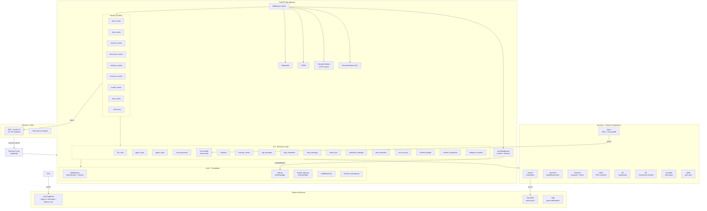
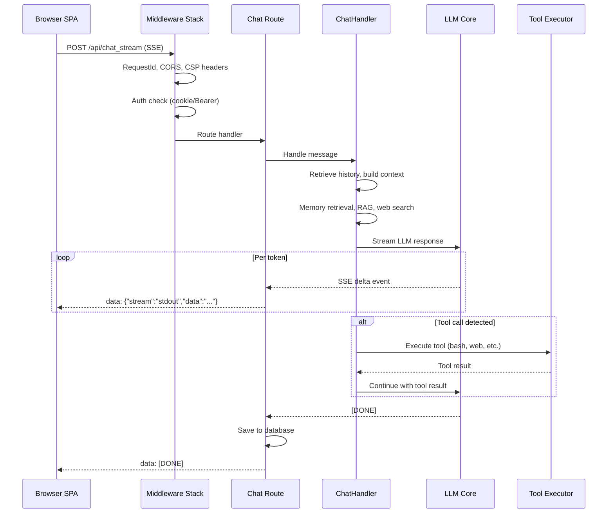
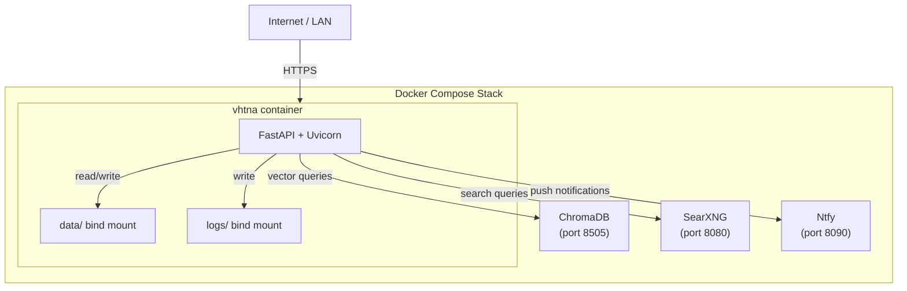
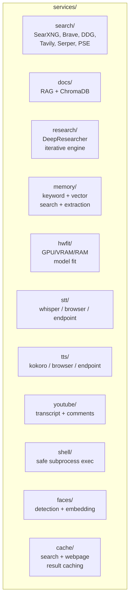

# VHT Network Automation — System Overview

## What Is VHT Network Automation

VHT Network Automation is a self-hosted AI workspace — a FastAPI Python server that serves a frontend SPA and exposes REST + streaming endpoints. It connects to any OpenAI-compatible LLM endpoint (or Anthropic, Ollama, OpenRouter, Groq) and provides:

- AI chat with streaming responses
- Agentic mode with tool use (bash, Python, file I/O, web search, MCP)
- Deep research with iterative web search and synthesis
- Document management with version history, PDF support, and AI-powered editing
- Persistent memory with keyword and vector search
- Calendar, notes, email, contacts, gallery, tasks
- Model management with multi-endpoint support, probing, and fallbacks
- MCP (Model Context Protocol) server integration
- Multi-user auth with TOTP 2FA, per-user privileges, and API tokens

### Intended Use Cases

| Use Case | Description |
|---|---|
| **Network automation assistant** | AI-powered interface for managing network devices, configurations, and diagnostics |
| **Personal AI workspace** | Chat, research, document editing, and task management in one place |
| **Local LLM playground** | Connect to local models (Ollama, vLLM, llama.cpp) with agentic tool use |
| **Deep research engine** | Iterative web search with multi-topic branching and synthesized reports |
| **Multi-user collaboration** | Team access with role-based privileges and shared data isolation |

---

## High-Level Architecture



### Request Flow (End-to-End)

When a user sends a chat message, the request traverses these layers:



---

## Component Dependency Graph

```mermaid
graph LR
    subgraph Layer1["Layer 1: core/ (no internal deps)"]
        C1["database.py"]
        C2["auth.py"]
        C3["feature_flags.py"]
        C4["middleware.py"]
        C5["constants.py"]
        C6["session_manager.py"]
        C7["exceptions.py"]
        C8["models.py"]
        C9["response_types.py"]
    end

    subgraph Layer2["Layer 2: src/ (depends on core/)"]
        S1["llm_core.py"]
        S2["agent_loop.py"]
        S3["agent_tools.py"]
        S4["chat_processor.py"]
        S5["chat_handler.py"]
        S6["memory.py"]
        S7["memory_vector.py"]
        S8["rag_manager.py"]
        S9["config.py"]
        S10["settings.py"]
        S11["embeddings.py"]
        S12["mcp_manager.py"]
        S13["task_scheduler.py"]
        S14["event_bus.py"]
        S15["endpoint_resolver.py"]
        S16["tool_execution.py"]
    end

    subgraph Layer3["Layer 3: routes/ (depends on src/ + core/)"]
        R1["auth_routes.py"]
        R2["chat_routes.py"]
        R3["research_routes.py"]
        R4["session_routes.py"]
        R5["document_routes.py"]
        R6["model_routes.py"]
        RN["... (38 more)"]
    end

    core --> src
    src --> routes
    core --> routes

    classDef core fill:#e8f5e9,stroke:#2e7d32,stroke-width:2px,color:#1b5e20
    classDef src fill:#e3f2fd,stroke:#1565c0,stroke-width:2px,color:#0d47a1
    classDef routes fill:#fff3e0,stroke:#e65100,stroke-width:2px,color:#bf360c

    class C1,C2,C3,C4,C5,C6,C7,C8,C9 core
    class S1,S2,S3,S4,S5,S6,S7,S8,S9,S10,S11,S12,S13,S14,S15,S16 src
    class R1,R2,R3,R4,R5,R6,RN routes
```



### Layer Responsibilities

**core/** — Foundation layer with zero dependencies on `src/` or `routes/`:
- `database.py`: SQLAlchemy models, schema migrations (`init_db()`), connection management
- `auth.py`: User CRUD, password hashing (bcrypt), session tokens, 2FA, API tokens, privilege system
- `feature_flags.py`: Immutable deploy-mode singleton read from env vars
- `middleware.py`: RequestId, SecurityHeaders (CSP nonce), RequestTimeout, AuthMiddleware
- `constants.py`: `BASE_DIR`, `DATA_DIR`, default paths
- `session_manager.py`: Legacy JSON-based session persistence (superseded by DB but still active for migration)

**src/** — Business logic depending only on `core/`:
- `llm_core.py`: HTTP dispatch to LLM endpoints with dead-host cooldown
- `agent_loop.py`: Tool-calling agent with context budget enforcement
- `chat_handler.py`: Session orchestration, message history, context assembly
- `chat_processor.py`: Context preface layers (memories, RAG, web, skills)
- `mcp_manager.py`: MCP server lifecycle (stdio, SSE, HTTP)
- `tool_execution.py`: Dispatches tool calls to built-in implementations or MCP

**routes/** — FastAPI `APIRouter` factories, one file per feature area. All dependencies injected via factory function arguments (see [Design Patterns](03-design-patterns.md)).

---

## Technology Stack

| Layer | Technology | Notes |
|---|---|---|
| Backend framework | FastAPI (async) | Auto-generated OpenAPI docs at `/docs` |
| HTTP server | Uvicorn (ASGI) | Production-ready with graceful shutdown |
| Database | SQLite (default) | Configurable via `DATABASE_URL` for PostgreSQL etc. |
| Vector store | ChromaDB (HTTP client) | Runs as separate service, port 8505 |
| Embeddings | ONNX runtime / fastembed / HTTP API | Automatic fallback chain |
| Frontend | Vanilla JavaScript SPA | 75+ ES modules, no framework dependency |
| Styling | Single monolithic CSS file | `static/style.css`, ~8000 lines |
| PWA | Service worker (sw.js) | Multi-strategy caching, offline support |
| Auth | bcrypt + cookie sessions + Bearer tokens | TOTP 2FA via pyotp + qrcode |
| Search | SearXNG (primary) + 5 fallback providers | Configurable per-provider API keys |
| Encryption | Fernet (cryptography library) | Secret storage for API keys in DB |
| Email | IMAP/SMTP via builtin `imaplib`/`smtplib` | No external email service required |
| Calendar | CalDAV | Uses `caldav` library |
| Scheduling | croniter | Standard cron expressions |
| MCP | `mcp` Python SDK | stdio, SSE, and HTTP transport |
| PDF | PyMuPDF (fitz) + pypdf | Text extraction, rendering, form filling |
| STT | faster-whisper / Web Speech API / endpoint | 3 backend options |
| TTS | Kokoro-82M / Web Speech API / endpoint | Cached audio output |

---

## Deployment Architecture



### Port Layout

| Service | Internal Port | External Port | Purpose |
|---|---|---|---|
| VHT Network Automation | 7000 | 7000 | Web UI + API |
| ChromaDB | 8505 | 8505 | Vector embeddings store |
| SearXNG | 8080 | 8080 | Privacy-respecting web search |
| Ntfy | 8090 | 8090 | Push notifications |

---

## Deployment Options

### Docker Compose (Primary)

```bash
# Start full stack
docker compose up -d --build

# View logs
docker compose logs --tail=120 vhtna

# Stop
docker compose down

# With GPU passthrough
docker compose --profile gpu up -d
```

Features:
- Data persisted via bind mounts (`./data/`, `./logs/`)
- Privilege dropping via `PUID`/`PGID` environment variables
- Healthchecks on SearXNG gate app startup
- Healthchecks on ChromaDB ensure vector store is ready
- GPU passthrough for local model serving

### macOS Native

```bash
./start-macos.sh
```

Direct uvicorn launch. Requires local ChromaDB and SearXNG instances.

### Windows Native

```powershell
.\launch-windows.ps1
```

PowerShell launch script. Assumes Python and dependencies are installed.

### Development Server

```bash
# Install dependencies
pip install -r requirements.txt
pip install -r requirements-optional.txt

# Start dev server
python -m uvicorn app:app --host 127.0.0.1 --port 7000 --reload

# Run tests
pytest
pytest tests/ -v -k "test_chat"
```

### Database Setup

```bash
# Fresh setup (creates DB and runs migrations)
python setup.py

# The DB is also auto-created at first startup via init_db()
```

---

## Configuration

VHT Network Automation is configured entirely through environment variables (`.env` file or container environment).

### Core Configuration

| Variable | Description | Default |
|---|---|---|
| `LLM_HOST` | Primary LLM endpoint URL | — |
| `LLM_HOSTS` | Comma-separated list of LLM endpoints for fallback | — |
| `OPENAI_API_KEY` | API key for LLM endpoint | — |
| `CHROMADB_HOST` | ChromaDB host | `localhost` |
| `CHROMADB_PORT` | ChromaDB port | `8505` |
| `DATABASE_URL` | SQLAlchemy connection string | `sqlite:///data/app.db` |
| `SEARXNG_INSTANCE` | SearXNG search instance URL | — |

### Auth Configuration

| Variable | Description | Default |
|---|---|---|
| `AUTH_ENABLED` | Enable authentication | `true` |
| `LOCALHOST_BYPASS` | Skip auth for localhost requests | `true` |
| `VHTNA_ADMIN_USER` | Initial admin username | — |
| `VHTNA_ADMIN_PASSWORD` | Initial admin password | — |
| `SECURE_COOKIES` | Set `secure` flag on session cookies | `false` |

### Feature Flags

| Variable | Description |
|---|---|
| `ODYSSEUS_DEPLOY_MODE=minimal` | Only research, documents, settings enabled |
| `ODYSSEUS_DEPLOY_MODE=enterprise` | All features enabled |
| `OFFLINE_MODE=true` | Disable all internet-dependent features |
| `ODYSSEUS_FEATURE_<NAME>=true/false` | Individual feature override (highest priority) |

**Note:** The `ODYSSEUS_*` environment variable names are preserved for backwards compatibility. They are read by `core/feature_flags.py` at import time.

### Speech Configuration

| Variable | Description | Default |
|---|---|---|
| `TTS_PROVIDER` | TTS backend: `browser`, `local`, `endpoint`, `disabled` | `browser` |
| `STT_PROVIDER` | STT backend: `browser`, `local`, `endpoint`, `disabled` | `browser` |

When set to `local`, the app uses Kokoro-82M for TTS and faster-whisper for STT. The `endpoint` option routes to an external API.

### Embeddings Configuration

| Variable | Description |
|---|---|
| `EMBEDDING_URL` | HTTP API URL for embeddings |
| `EMBEDDING_MODEL` | Model name for HTTP-based embeddings |
| `FASTEMBED_MODEL` | Local fastembed model name |

The embedding client (`src/embeddings.py`) tries backends in order:
1. HTTP API (`EMBEDDING_URL`)
2. ONNX runtime (local)
3. fastembed library

### Search Provider API Keys

| Variable | Service |
|---|---|
| `BRAVE_API_KEY` | Brave Search API |
| `GOOGLE_API_KEY` | Google Custom Search |
| `GOOGLE_PSE_ID` | Google Programmable Search Engine ID |
| `TAVILY_API_KEY` | Tavily Search API |
| `SERPER_API_KEY` | Serper.dev API |

---

## Data Storage

All persistent data lives in the `data/` directory:

```
data/
  app.db              # SQLite database — all relational data
  auth.json           # User accounts with bcrypt password hashes
  sessions.json       # Session token persistence
  settings.json       # App-wide settings (admin-managed)
  features.json       # Runtime feature flag overrides
  prefs.json          # Per-user preferences (UI state, theme, etc.)
  integrations.json   # Third-party integration configurations
  deep_research/      # Completed research result JSON files
  uploads/            # Uploaded files (PDFs, images, attachments)
  chroma/             # ChromaDB persistent vector storage
  hf_models.json      # HuggingFace model catalog cache (hwfit)
```

### Database Tables

The SQLite database (`app.db`) contains these models (defined in `core/database.py`):

| Table | Purpose |
|---|---|
| `users` | User accounts, bcrypt hashes, TOTP secrets, privileges |
| `sessions` | Chat sessions with title, folder, archived status |
| `chat_messages` | Individual messages within sessions |
| `documents` | Documents with content, language, version tracking |
| `document_versions` | Version history snapshots |
| `memories` | Memory entries with category, importance, pinned status |
| `model_endpoints` | LLM endpoint configurations (host, API key, provider) |
| `mcp_servers` | MCP server configurations (type, command, args) |
| `scheduled_tasks` | Cron-style task definitions |
| `task_runs` | Execution history for scheduled tasks |
| `webhooks` | Outbound webhook configurations |
| `api_tokens` | Bearer token credentials (`vhtna_*` prefixed) |
| `notes` | Personal notes and todos |
| `gallery_images` | Image metadata and thumbnails |
| `gallery_albums` | Photo album groupings |
| `calendar_accounts` | CalDAV connection details |
| `calendar_cals` | Synced calendar metadata |
| `calendar_events` | Cached calendar events |
| `email_accounts` | IMAP/SMTP connection details |
| `comparisons` | Model comparison session data |
| `signatures` | Captured signature images |
| `contacts` | Personal contact entries |
| `editor_drafts` | Unsaved editor session drafts |
| `integrations` | Third-party service integrations |
| `user_tools` | Per-user tool enable/disable state |
| `skills` | Custom skill definitions |

---

## Services Architecture



| Service | Location | Description | Key Features |
|---|---|---|---|
| Search | `services/search/` | Multi-provider web search | 6 backends with automatic fallback |
| Docs (RAG) | `services/docs/` | Retrieval-augmented generation | ChromaDB vector search, document chunking |
| Research | `services/research/` | Deep iterative research | Multi-topic branching, synthesis engine |
| Memory | `services/memory/` | Persistent memory system | Keyword + vector search, AI extraction |
| HW Fit | `services/hwfit/` | Hardware model recommendation | GPU VRAM analysis, RAM constraints |
| STT | `services/stt/` | Speech-to-text | faster-whisper, Web Speech API, HTTP endpoint |
| TTS | `services/tts/` | Text-to-speech | Kokoro-82M model, Web Speech API, HTTP endpoint |
| YouTube | `services/youtube/` | Transcript extraction | Video transcript + comment retrieval |
| Shell | `services/shell/` | Safe command execution | Sandboxed subprocess, timeout enforcement |
| Faces | `services/faces/` | Face detection | Detection + embedding for gallery |
| Cache | `services/cache/` | Result caching | Search + webpage result deduplication |
