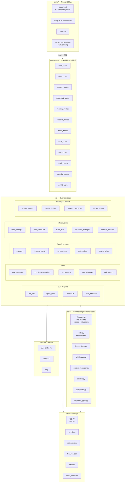
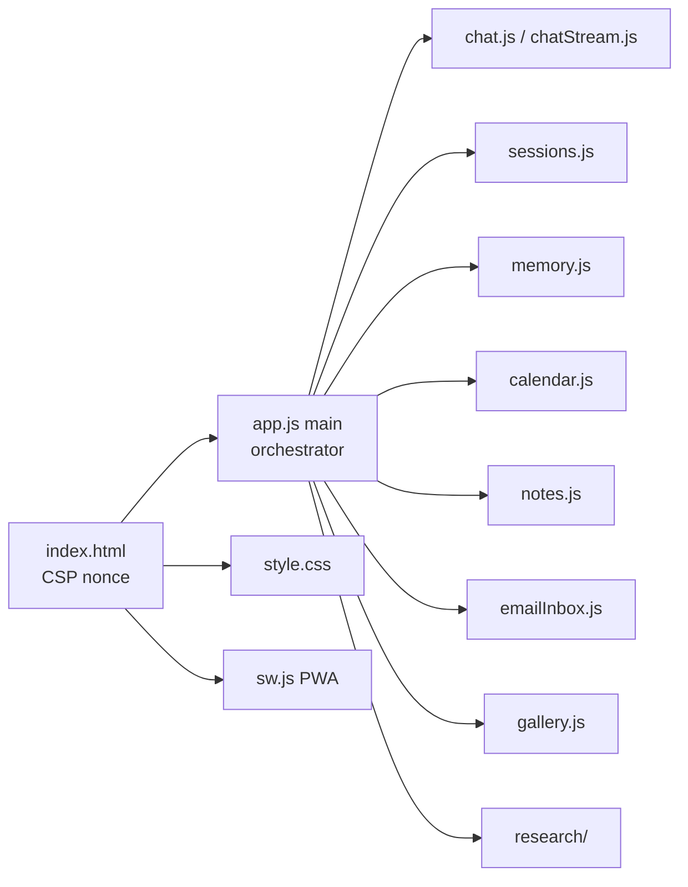
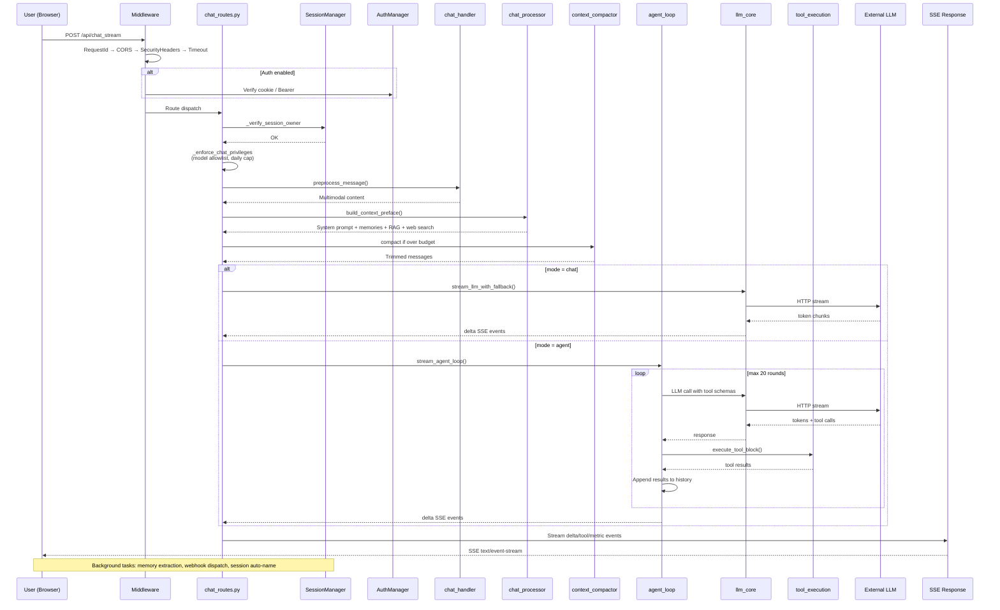
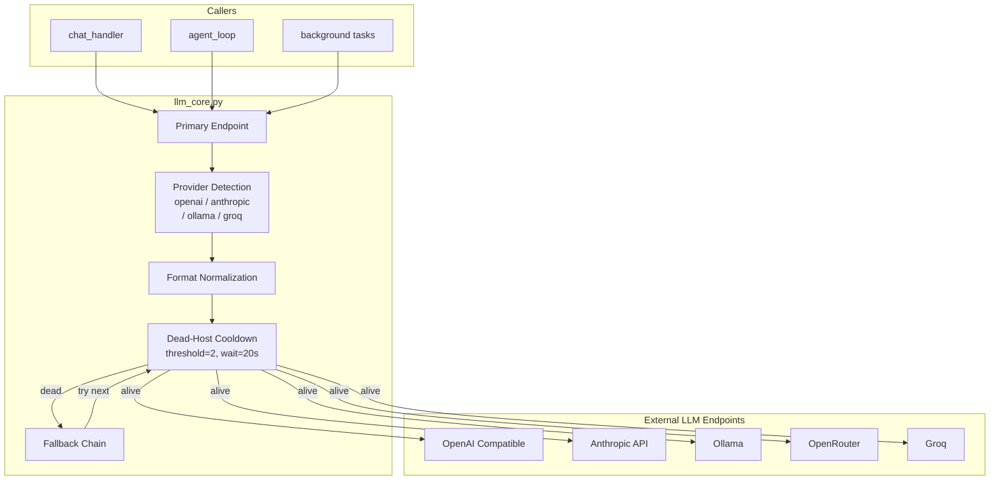
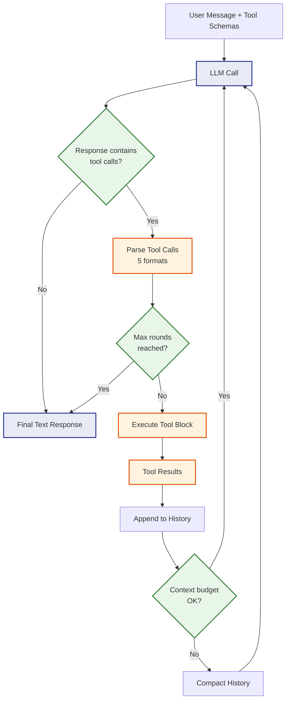
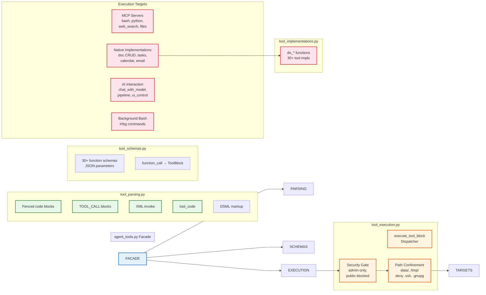
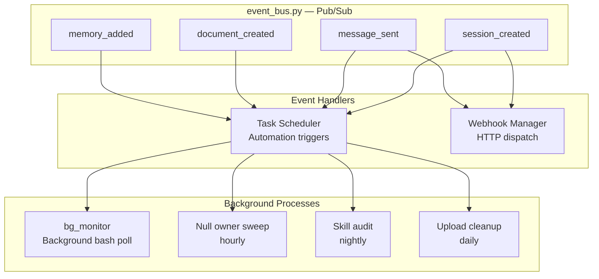
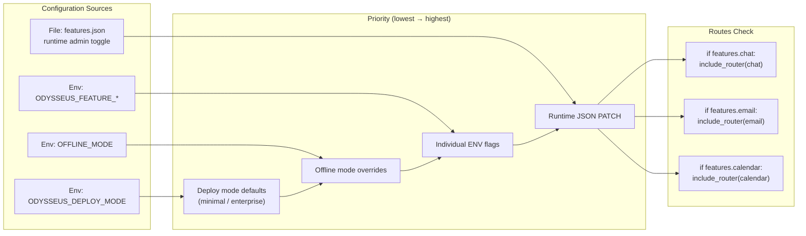

# VHT Network Automation — Architecture

## High-Level Layered Architecture



---

## Layered Design

### `core/` — Foundation Layer

No dependency on `src/` or `routes/`. Provides the building blocks:

- **`database.py`**: SQLAlchemy models, schema migrations, `SessionLocal`, `EncryptedText` type
- **`auth.py`**: `AuthManager` — password hashing, token management, user CRUD, 2FA
- **`middleware.py`**: RequestIdMiddleware, SecurityHeadersMiddleware, `require_admin()`
- **`constants.py`**: `BASE_DIR`, `DATA_DIR`, env defaults
- **`feature_flags.py`**: Immutable `FeatureFlags` singleton
- **`exceptions.py`**: Domain-specific exceptions (`SessionNotFoundError`, `LLMServiceError`, etc.)
- **`response_types.py`**: Standard JSON response helpers (`success_response`, `error_response`)
- **`models.py`**: Pure data models (`Session`, `ChatMessage`)
- **`session_manager.py`**: DB-backed session CRUD with in-memory cache

### `src/` — Business Logic

Depends on `core/`, not on `routes/`. Contains all domain logic:

**LLM & Agent:**
- `llm_core.py` — HTTP dispatch to LLM endpoints with dead-host cooldown, caching, streaming
- `agent_loop.py` — Tool-calling loop with max-step limit, context budget, tool result handling
- `chat_handler.py` — Session orchestration: create, continue, stream messages
- `chat_processor.py` — Context preface assembly: system prompt, memories, RAG, web, skills
- `agent_tools.py` — Facade re-exporting all tool modules

**Tools:**
- `tool_execution.py` — Dispatches `ToolBlock` to implementations or MCP
- `tool_implementations.py` — 30+ native `do_*` functions (doc CRUD, notes, calendar, email, bash, python, etc.)
- `tool_parsing.py` — Parses tool calls from LLM output in 5 formats (JSON, XML, DSML, fenced, `tool_code`)
- `tool_schemas.py` — 30+ JSON schema definitions for tool parameters
- `tool_security.py` — Admin-only blocks, path confinement, incognito filtering

**Memory & Data:**
- `memory.py` — Keyword-based persistent memory with importance scoring
- `memory_vector.py` — ChromaDB vector memory with semantic search
- `rag_manager.py` — Document RAG with ChromaDB chunking and retrieval
- `rag_singleton.py` — Lazy RAG manager initialization
- `embeddings.py` — ONNX/fastembed/HTTP embedding client with automatic fallback chain
- `chroma_client.py` — HTTP client wrapping ChromaDB API

**Infrastructure:**
- `mcp_manager.py` — MCP server lifecycle (stdio/SSE/HTTP), connection pooling, tool listing
- `task_scheduler.py` — Cron-based + event-driven task scheduler using croniter
- `event_bus.py` — In-process pub/sub for cross-component events
- `webhook_manager.py` — Outbound HTTP POST dispatch with HMAC signing
- `endpoint_resolver.py` — Provider-specific URL resolution and normalization
- `model_discovery.py` — LLM endpoint model list discovery and probing
- `model_context.py` — Context window size mappings per model

**Security & Context:**
- `prompt_security.py` — Untrusted content policy wrapper for LLM context
- `context_budget.py` — Token usage tracking and budget enforcement
- `context_compactor.py` — Self-summary message history compression
- `secret_storage.py` — Fernet-based encryption for DB secrets

**Other:**
- `config.py` — Pydantic-settings-based app configuration
- `settings.py` — User/admin settings load/save
- `app_initializer.py` — Component initialization factory
- `document_actions.py` — Document CRUD as tool-callable actions
- `document_processor.py` — Document processing pipeline (PDF, markdown, etc.)
- `upload_handler.py` — File upload management
- `preset_manager.py` — Chat preset management
- `auth_helpers.py` — Request-level auth helpers (`get_current_user`)

### `routes/` — API Layer

Depends on `src/` and `core/`. One file per feature area. Factory-function pattern:

```python
# app.py
from routes.chat_routes import setup_chat_routes
router = setup_chat_routes(session_manager, chat_handler, chat_processor, ...)
app.include_router(router)

# routes/chat_routes.py
def setup_chat_routes(session_manager, chat_handler, ...) -> APIRouter:
    router = APIRouter(tags=["chat"])
    
    @router.post("/api/chat_stream")
    async def chat_stream(request: Request):
        # Validate session ownership
        # Enforce chat privileges (model allowlist, daily cap)
        # Build context preface
        # Stream LLM response via SSE
        ...
    
    return router
```

### `static/` — Frontend SPA



**Key files:**
- `index.html` — Main SPA entry with `{{CSP_NONCE}}` template injection
- `app.js` — Orchestrator/loader, wires 30+ feature modules to DOM events
- `js/chat.js` — Core chat UI: message rendering, input handling, SSE stream consumption
- `js/chatStream.js` — SSE event stream consumer with tool call rendering
- `js/sessions.js` — Session list, folders, auto-sort, archiving
- `js/chatRenderer.js` — Markdown rendering, code highlighting, mermaid diagram support
- `js/slashCommands.js` — `/` commands: skills, code execution, tool shortcuts
- `js/storage.js` — localStorage abstraction layer with auto-migration from `odysseus-*` to `vhtna-*` keys
- `js/theme.js` — Theme management (dark/light/custom)
- `style.css` — Monolithic stylesheet (~8000 lines)
- `sw.js` — Service worker with multi-strategy caching
- `manifest.json` — PWA web app manifest

---

## App Initialization Flow

```mermaid
flowchart TD
    START[("START")] --> MIDDLEWARE["Apply Middleware Stack\nRequestId → CORS → SecurityHeaders\n→ Timeout → Auth"]

    MIDDLEWARE --> INIT["initialize_managers()\nCreate all services from\napp_initializer.py"]

    INIT[""] --> ROUTES["Register Routes via\nsetup_<name>_routes()\n(factory functions)"]

    ROUTES --> STARTUP["Startup Hooks"]

    STARTUP --> PURGE["Purge incognito sessions"]
    STARTUP --> UPLOAD["Start upload cleanup"]
    STARTUP --> BG["Start bg_monitor"]
    STARTUP --> MCP["Connect MCP servers\n20s timeout, non-fatal"]
    STARTUP --> TOOLS["Pre-warm tool index"]
    STARTUP --> PING["Pre-warm LLM pings\nevery 60s"]
    STARTUP --> TASKS["Ensure default\ntask schedules"]
    STARTUP --> SCHED["Start task scheduler"]
    STARTUP --> SWEEP["Start hourly\nnull-owner sweep"]
    STARTUP --> AUDIT["Start nightly skill audit"]

    SUBSCRIBE["App serves HTTP"]
    STARTUP --> SUBSCRIBE

    SUBSCRIBE --> SHUTDOWN["Shutdown Event"]

    SHUTDOWN --> CANCEL["Cancel upload cleanup"]
    SHUTDOWN --> STOP["Stop task scheduler"]
    SHUTDOWN --> CLOSE["Close webhook manager"]
    SHUTDOWN --> DISC["Disconnect MCP servers"]

    END[("STOP")]

    classDef init fill:#e3f2fd,stroke:#1565c0,stroke-width:2px
    classDef startup fill:#fff3e0,stroke:#e65100,stroke-width:2px
    classDef shutdown fill:#fce4ec,stroke:#c62828,stroke-width:2px

    class MIDDLEware,INIT,ROUTES init
    class PURGE,UPLOAD,BG,MCP,TOOLS,PING,TASKS,SCHED,SWEEP,AUDIT startup
    class CANCEL,STOP,CLOSE,DISC shutdown
```

### Startup Hook Details

| Hook | What It Does | Failure Behavior |
|---|---|---|
| Purge incognito sessions | Deletes sessions marked as incognito from previous run | Non-fatal |
| Upload cleanup | Background task that removes stale uploads | Non-fatal |
| bg_monitor | Polls for background bash job completion | Non-fatal |
| MCP connect | Connects all configured MCP servers with 20s timeout | Non-fatal per server |
| Tool index pre-warm | Builds in-memory tool index for agent | Non-fatal |
| LLM pings | Pings all configured endpoints every 60s | Non-fatal per endpoint |
| Task scheduler | Starts cron-based scheduler | Non-fatal |
| Null-owner sweep | Hourly migration of unowned rows to admin | Non-fatal |
| Skill audit | Nightly cleanup of stale skills | Non-fatal |

All startup hooks are non-fatal — a failure in one does not block app startup.

---

## Middleware Stack

```mermaid
graph LR
    REQUEST[("Incoming Request")] --> MW1["1. RequestIdMiddleware"]
    MW1 -->|"adds X-Request-Id\nlogs method/path/status"| MW2["2. CORSMiddleware"]
    MW2 -->|"origin check\ncredentials"| MW3["3. SecurityHeadersMiddleware"]
    MW3 -->|"CSP nonce\nX-Content-Type-Options\nX-Frame-Options"| MW4["4. RequestTimeoutMiddleware"]
    MW4 -->|"45s hard timeout\n(excludes streaming)"| MW5["5. AuthMiddleware"]
    MW5 -->|"exempt paths\nlocalhost bypass\nBearer tokens\nsession cookies"| ROUTES["Route Handler"]

    classDef mw fill:#e8f5e9,stroke:#2e7d32,stroke-width:2px,color:#1b5e20
    class MW1,MW2,MW3,MW4,MW5 mw
```



Middleware executes in outer-to-inner order of registration (last registered runs closest to handler):

1. **RequestIdMiddleware** — Generates `X-Request-ID`, timestamps requests, logs `method/path/status/duration`
2. **CORSMiddleware** — Configurable origins, credentials support, custom header allowlist
3. **SecurityHeadersMiddleware** — Per-request CSP nonce generation, `X-Content-Type-Options: nosniff`, `X-Frame-Options: DENY`, `Strict-Transport-Security`
4. **RequestTimeoutMiddleware** — Hard 45s timeout for non-streaming endpoints. Excludes streaming, upload, and image rendering endpoints.
5. **AuthMiddleware** — Conditional (enabled by `AUTH_ENABLED=true`). Path exemption list, internal tool bypass, localhost bypass, Bearer API tokens, cookie sessions.

### Request Timeout Exclusions

The following endpoint types are excluded from the 45s timeout:
- SSE streaming endpoints (`/api/chat_stream`, `/api/shell/stream`, `/api/research/stream/*`)
- File upload endpoints (`/api/upload`)
- Image rendering (`/api/document/*/page/*.png`)
- Long-running research (`/api/research/*`)

---

## Request Flow: Chat Message (Streaming)



### Context Preface Layers

When `chat_processor.py` builds the context, it assembles these layers in order:

1. **Preset system prompt** — From active chat preset or default
2. **Prompt safety policy** — System instructions for model behavior
3. **Pinned memories** — Always-included memory entries
4. **Vector/search memories** — Semantic memory retrieval
5. **RAG results** — Retrieved document chunks from ChromaDB
6. **Web search results** — If `use_web` flag is set
7. **URL content** — If URL attachments are included
8. **Skills index** — Tool descriptions (agent mode only)

### Memory Recall: Hybrid BM25 + Vector Similarilarity

`src/chat_processor.py:52-118` implements memory recall as a hybrid scoring scheme:

- **BM25-inspired keyword score** (`_bm25_score(query_toks, mem_id)`)
- **Optional vector similarity** against the user's memory collection
- **Recency tiebreaker** (newer memories win ties)

Entries with similarity below `RAG_SIMILARITY_THRESHOLD = 0.35` (`src/chat_processor.py:52`) are filtered out before being injected into the context preface.

### SSE Event Types

The chat stream emits these events:

| Event | Data | Purpose |
|---|---|---|
| `delta` | `{"stream":"stdout","data":"..."}` | Token chunk |
| `tool_start` | `{"tool":"name","args":...}` | Tool call beginning |
| `tool_output` | `{"tool":"name","output":"..."}` | Tool result |
| `agent_step` | `{"step":n,"thought":"..."}` | Agent reasoning step |
| `doc_update` | `{"doc_id":"...","content":"..."}` | Document content update |
| `web_sources` | `[{"title":"...","url":"..."}]` | Web search sources |
| `research_progress` | `{"stage":"...","progress":0.0-1.0}` | Research progress |
| `research_done` | `{"title":"...","summary":"..."}` | Research completion |
| `metrics` | `{"tokens":n,"time":n}` | Token usage and timing |
| `model_info` | `{"model":"..."}` | Model identification |
| `compacted` | `{}` | Context was compacted |
| `[DONE]` | — | Stream complete |

---

## Auth Middleware Decision Flow

```mermaid
flowchart TD
    A[Request arrives] --> B{Auth enabled?}
    B -->|No| H["Set current_user = None\nProceed to handler"]
    B -->|Yes| C{Path exempt?}
    C -->|"static, favicon, health"| H
    C -->|No| D{Internal tool token?}
    D -->|"X-VHTNA-Internal-Token"| E{"Loopback only?"}
    E -->|Yes| F["Set current_user\ninternal-tool"]
    E -->|No| G{Localhost bypass?}
    D -->|No| G
    G -->|"localhost + not proxied"| F
    G -->|No| K{Auth configured?}
    K -->|No| L["Redirect /login"]
    K -->|Yes| M{Bearer token?}
    M -->|"vhtna_* prefix"| N{"Cache hit?"}
    N -->|Yes| O["Verify bcrypt\nSet current_user"]
    N -->|No|"Load from DB\nPopulate cache\nVerify bcrypt" --> O
    M -->|No| P{Session cookie?}
    P -->|No| Q{Wants HTML?}
    Q -->|Yes| L
    Q -->|No| R["401 Unauthorized"]
    P -->|Yes| S{"Token valid?"}
    S -->|No| Q
    S -->|Yes| O

    F --> H
    O --> T["Route handler\nwith current_user"]
    L --> T
    T --> U[("Response")]
```

---

## LLM Dispatch Architecture



### LLM Core Features

**Provider auto-detection** from URL patterns:
- `openai.com` → OpenAI-format: standard chat completions, tool calls as function calls
- `anthropic.com` → Anthropic-format: system message extraction, `tool_use`/`tool_result` blocks
- `ollama` → Ollama-native format with adapted tool schemas
- `openrouter.ai` → OpenAI format with provider routing
- `groq.com` → OpenAI format with specific capabilities

**Format normalization** per provider — messages are transformed into the provider's expected format before dispatch. This includes:
- Separating system messages from conversation history (Anthropic)
- Converting tool call formats between providers
- Adjusting role labels as required

**Streaming**: `stream_llm()` is an async generator yielding SSE chunks. Used by chat and agent endpoints.

**Sync calls**: `llm_call()` supports response caching (128-entry LRU, keyed on message content hash).

**Fallback chains**: `stream_llm_with_fallback()` and `llm_call_with_fallback()` try endpoints in order, skipping dead hosts.

### Dead-Host Cooldown

```python
# src/llm_core.py:144-153 — failure tracking guarded by a Lock
DEAD_HOST_COOLDOWN = 20.0
_HOST_FAIL_THRESHOLD = 2
_dead_hosts: Dict[str, float] = {}
_host_fails: Dict[str, int] = {}
_host_health_lock = threading.Lock()
```

The synchronous `llm_call()` runs inside FastAPI's threadpool (used by sync routes like `/sessions/auto-sort`) while `llm_call_async()` runs on the event loop. Without the lock, the read-modify-write on `_host_fails` lost failure counts under concurrent connect errors (issue #659). After 2 consecutive failures the host is cooled for 20 seconds; any success resets the failure counter immediately.

---

## Agent Loop



### Agent Loop Configuration

| Parameter | Default | Description |
|---|---|---|
| Max steps | 20 | Maximum tool call rounds before forcing response |
| Context budget | 6000 tokens default (scaled to model context window × 0.85, capped at 200K) | Triggers compaction at 85% of context window |
| Tool result size limit | 100KB | Per-tool output truncation |
| Tool timeout | 30s | Per-tool execution timeout |

### Tool Call Parsing (5 Formats)

`tool_parsing.py` handles these LLM output formats:

1. **JSON code blocks** — ```json {"tool":"name","args":{}} ```
2. **TOOL_CALL blocks** — `TOOL_CALL: name({"arg":"val"})`
3. **XML invoke** — `<invoke tool="name"><arg>val</arg></invoke>`
4. **tool_code** — Special markdown code block with tool language
5. **DSML markup** — Domain-specific markup language for tool calls

---

## Tool System



### Native Implementations (`tool_implementations.py`)

These `do_*` functions are built-in tool implementations:

| Function | Tool | Description |
|---|---|---|
| `do_read_file(path)` | `read_file` | Read file contents |
| `do_write_file(path, content)` | `write_file` | Write file contents |
| `do_bash(cmd)` | `bash` | Execute bash command |
| `do_python(code)` | `python` | Execute Python code (exec) |
| `do_web_search(query)` | `web_search` | Multi-provider web search |
| `do_web_fetch(url)` | `web_fetch` | Fetch URL content |
| `do_browser(url)` | `builtin_browser` | Headless browser capture |
| `do_generate_image(prompt)` | `generate_image` | Image generation |
| `do_list_documents()` | `list_documents` | List user documents |
| `do_get_document(id)` | `get_document` | Read document content |
| `do_create_document(title, content)` | `create_document` | Create new document |
| `do_edit_document(id, content)` | `edit_document` | Edit document content |
| `do_list_sessions()` | `list_sessions` | List chat sessions |
| `do_create_session(name)` | `create_session` | Create chat session |
| `do_send_to_session(sid, msg)` | `send_to_session` | Post message to session |
| `do_search_chats(query)` | `search_chats` | Search across sessions |
| `do_list_calendar_events(start, end)` | `list_calendar_events` | Query calendar |
| `do_create_calendar_event(...)` | `create_calendar_event` | Create event |
| `do_list_notes()` | `list_notes` | List notes |
| `do_create_note(content)` | `create_note` | Create note |
| `do_list_contacts()` | `list_contacts` | List contacts |
| `do_list_emails()` | `list_emails` | List email inbox |
| `do_send_email(to, subject, body)` | `send_email` | Send email |
| `do_list_models()` | `list_models` | List available models |
| `do_manage_memory(action, ...)` | `manage_memory` | Memory CRUD |
| `do_manage_skills(action, ...)` | `manage_skills` | Skill management |
| `do_manage_tasks(action, ...)` | `manage_tasks` | Task management |
| `do_chat_with_model(model, msg)` | `chat_with_model` | Direct model call |
| `do_ui_control(action, ...)` | `ui_control` | UI state changes |

---

## Database Model Relationships

```mermaid
erDiagram
    Session ||--o{ ChatMessage : "has"
    Session ||--o{ Document : "contains"
    Document ||--o{ DocumentVersion : "versions"
    Session ||--o{ ScheduledTask : "schedules"
    ScheduledTask ||--o{ TaskRun : "runs"
    Session ||--o{ CrewMember : "members"
    GalleryAlbum ||--o{ GalleryImage : "images"
    EmailAccount ||--|{ EmailMessage : "messages"
    CalendarCal ||--o{ CalendarEvent : "events"
    ModelEndpoint }o--|| User : "owned by"
    McpServer }o--|| User : "owned by"
    ApiToken }o--|| User : "owned by"
    Webhook }o--|| User : "owned by"
    Document }o--|| User : "owned by"
    Memory }o--|| User : "owned by"

    Session {
        string id PK
        string owner
        string name
        string model
        string endpoint_url
        string mode
        int message_count
        boolean is_important
        boolean archived
        datetime created_at
        datetime updated_at
    }

    ChatMessage {
        int id PK
        string session_id FK
        string owner
        string role
        text content
        json metadata
        datetime timestamp
    }

    Document {
        string id PK
        string session_id FK
        string owner
        string title
        string language
        text current_content
        int version_count
        boolean is_active
        boolean archived
    }

    DocumentVersion {
        string id PK
        string document_id FK
        int version_number
        text content
        string summary
        string source
        datetime created_at
    }

    ModelEndpoint {
        string id PK
        string name
        string base_url
        encrypted_text api_key EncryptedText
        string cached_models
        string hidden_models
        string model_type
        boolean is_enabled
    }

    User {
        string username PK
        hashed_password text
        is_admin boolean
        json privileges JSON
        totp_secret text
        totp_backup_codes JSON
    }
```

### Database Initialization

Schema migrations run at startup via `init_db()` in `core/database.py`:

```python
def init_db():
    """Create all tables and run migrations."""
    engine = create_engine(DATABASE_URL)
    Base.metadata.create_all(engine)
    _run_migrations(engine)
```

Migrations are incremental SQL statements tracked in a `_migrations` table. New migrations are added to the end of `_run_migrations()` and run only once.

---

## Event System & Background Processing



### EventBus Implementation

`src/event_bus.py` is **not** a generic in-process pub/sub — there is no subscriber callback list. It is a DB-driven task trigger. Module-level `fire_event(event_name, owner)` schedules `_handle_event(...)` on the running loop. `_handle_event` queries the DB for `ScheduledTask` rows whose `trigger_event` matches the fired event, increments each task's `trigger_counter`, and — once the counter reaches the task's configured `trigger_count` threshold — calls `_task_scheduler.run_task_now(task.id)`.

```python
# src/event_bus.py — fires an event (safe from sync or async contexts)
def fire_event(event_name: str, owner: Optional[str] = None):
    try:
        loop = asyncio.get_running_loop()
        loop.create_task(_handle_event(event_name, owner))
    except RuntimeError:
        asyncio.run(_handle_event(event_name, owner))

async def _handle_event(event_name, owner):
    # Query DB: ScheduledTask WHERE trigger_event == event_name AND status == "active"
    # For each matching task: trigger_counter += 1
    # If trigger_counter >= task.trigger_count: reset to 0, set next_run <= now,
    #   call _task_scheduler.run_task_now(task.id)
```

### Background Job Monitor

The `bg_monitor` watches for bash commands prefixed with `#!bg`. These run as subprocesses and the monitor polls for completion. When a job finishes, the output is reinjected into the agent loop via the session manager.

---

## Feature Flag System



### Route Registration by Feature

Feature-flagged routes are conditionally added in `app.py`:

```python
# app.py
features = FeatureFlags()

if features.chat:
    app.include_router(setup_chat_routes(...))
if features.calendar:
    app.include_router(setup_calendar_routes(...))
if features.email:
    app.include_router(setup_email_routes(...))
if features.memory:
    app.include_router(setup_memory_routes(...))
# ... etc.
```

The SPA also checks feature flags via `GET /api/auth/features` to conditionally show/hide UI panels.

---

## Auth Architecture

```mermaid
classDiagram
    class AuthManager {
        +dict users
        +dict sessions
        +bool signup_enabled
        +bool is_configured
        setup(username, password)
        create_user(username, password, is_admin)
        verify_password(username, password) bool
        create_session(username, remember) str
        revoke_token(token)
        revoke_user_sessions(username)
        get_username_for_token(token) str
        status(token) dict
        is_admin(username) bool
        get_privileges(username) dict
        set_privileges(username, privs)
        rename_user(old, new)
        delete_user(username)
        totp_enabled(username) bool
        totp_generate_secret(username) str
        totp_verify(username, code) bool
        totp_confirm_enable(username, code) bool
        totp_disable(username, password) bool
    }

    class UserPrivs {
        +can_use_agent bool
        +can_use_browser bool
        +can_use_bash bool
        +can_use_documents bool
        +can_use_research bool
        +can_generate_images bool
        +can_manage_memory bool
        +max_messages_per_day int
        +allowed_models list
    }

    AuthManager "-- "UserPrivs : manages
```

---

## Context Management

The agent soft-trims its input context to `agent_input_token_budget` tokens (default 6000, capped at 200K). `src/context_budget.py:21` exposes a pure function `compute_input_token_budget(configured, context_length, explicit, ...)`:

- If the user explicitly set the budget → honour it exactly (clamped to the model's window when known).
- Otherwise → scale to `headroom` (0.85) of the model's discovered context window, capped at `DEFAULT_HARD_MAX = 200_000`.
- When the window is unknown → fall back to the configured/default value.

`src/context_compactor.py` handles overflow:

- `COMPACT_THRESHOLD = 0.85` — at 85% of the context window, `maybe_compact(...)` summarizes the older half via the same LLM, keeping the recent half verbatim.
- `SELF_SUMMARY_SYSTEM_PROMPT` produces a Cursor-style structured summary: **User Goal**, **What Was Done**, **Current State**, **Pending / Next Steps**, **Key Context**.
- `trim_for_context(...)` drops RAG/memory system messages before conversation turns, then truncates the current user message if it alone exceeds the model window.
