# VHT Network Automation — Design Patterns

## Singleton

Immutable or mutable singletons initialized once and used globally.

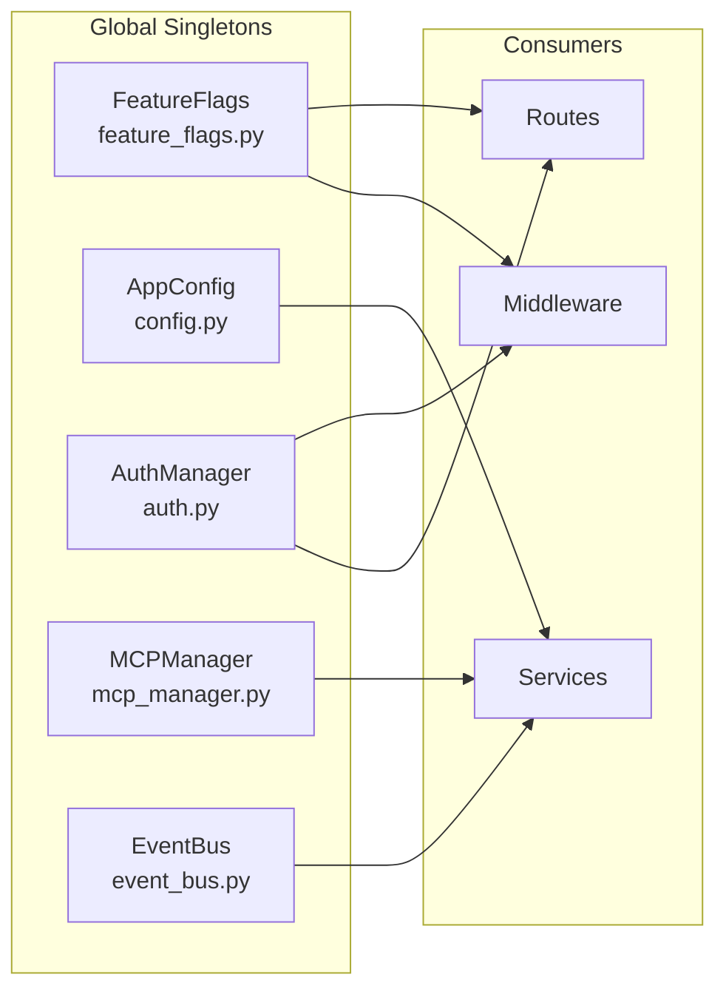

### FeatureFlags (`core/feature_flags.py`)

Immutable after construction. Read from env vars at import time.

```python
class FeatureFlags:
    """Immutable after construction. Read from env at import time."""
    chat = True
    agent_mode = True
    research = True
    # ... (20+ feature flags)

features = FeatureFlags()  # Global singleton
```

- `ODYSSEUS_DEPLOY_MODE=minimal` or `enterprise` sets defaults
- `ODYSSEUS_FEATURE_<NAME>` overrides individual flags
- Runtime updates via PATCH `/api/features` use `object.__setattr__` on the singleton:

```python
@app.patch("/api/features")
async def update_features(payload: dict):
    for key, value in payload.items():
        if hasattr(features, key):
            object.__setattr__(features, key, value)
    # Persist to features.json
```

### AppConfig (`src/config.py`)

```python
class AppConfig(BaseSettings):
    llm: LLMConfig = LLMConfig()
    search: SearchConfig = SearchConfig()
    # ...

config = AppConfig()  # Global singleton
```

Pydantic-settings-based. Validates at startup with type checking.

### AuthManager (`core/auth.py`)

Created once in `app.py`, accessed via `request.app.state.auth_manager`. Not a module-level singleton — attached to app state for lifecycle management.

### MCPManager (`src/mcp_manager.py`)

Set once via `set_mcp_manager()`. Lazy singleton accessed from routes. Provides connection pooling for MCP server processes.

### EventBus (`src/event_bus.py`)

Module-level singleton used for in-process pub/sub. Subscribers register at startup; events are fired from route handlers.

---

## Factory Pattern

### `initialize_managers()` (`src/app_initializer.py`)

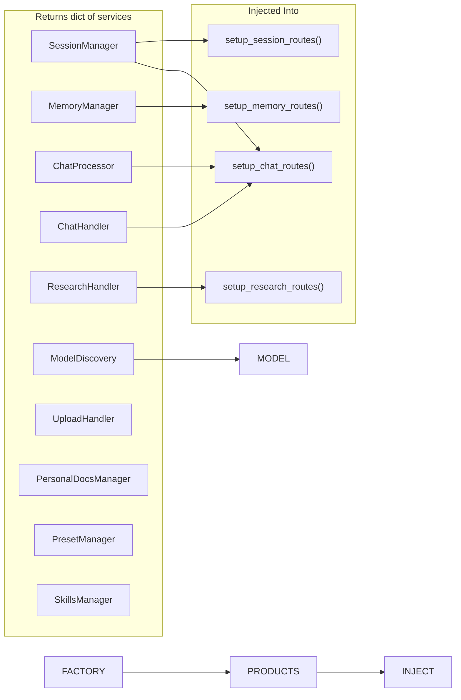

Returns a dictionary of all initialized services. Dependencies injected into route setup functions:

```python
# app.py
from src.app_initializer import initialize_managers

managers = initialize_managers(config)
app.include_router(setup_chat_routes(
    managers["session_manager"],
    managers["chat_handler"],
    managers["chat_processor"],
    managers["chat_history"],
    managers["model_discovery"],
    managers["auth_manager"],
))
```

This pattern makes dependencies explicit and testable — each route can be tested with mock managers.

---

## Dependency Injection via Factory Functions

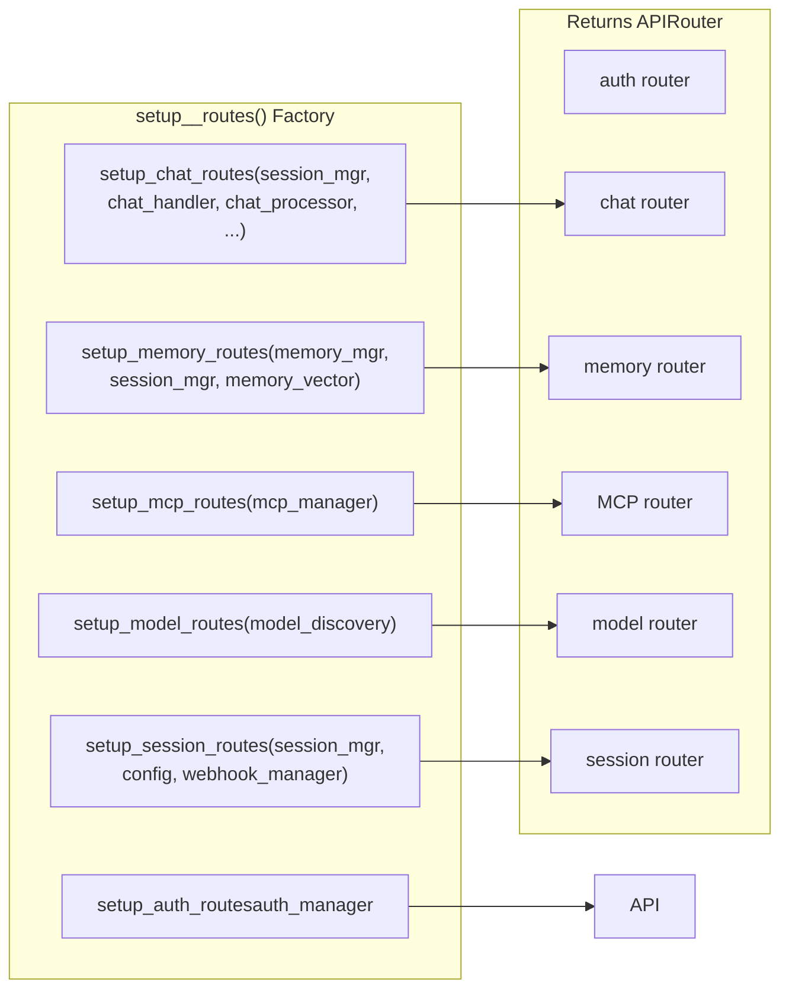

All routes are registered via factory functions that receive their dependencies:

```python
setup_auth_routes(auth_manager: AuthManager) -> APIRouter
setup_chat_routes(session_manager, chat_handler, chat_processor, ...) -> APIRouter
setup_memory_routes(memory_manager, session_manager, memory_vector) -> APIRouter
setup_mcp_routes(mcp_manager: McpManager) -> APIRouter
setup_model_routes(model_discovery) -> APIRouter
setup_session_routes(session_manager, config, webhook_manager) -> APIRouter
```

Benefits:
- Avoids global imports in route files (testable with mocks)
- Makes dependencies explicit at a glance
- Enables lazy initialization of expensive components
- Simplifies testing — pass `MagicMock()` instances:

```python
def test_chat_route():
    mock_sm = MagicMock()
    mock_ch = MagicMock()
    router = setup_chat_routes(mock_sm, mock_ch, ...)
    # Test the route
```

---

## Facade Pattern

### Tool System (`src/agent_tools.py`)

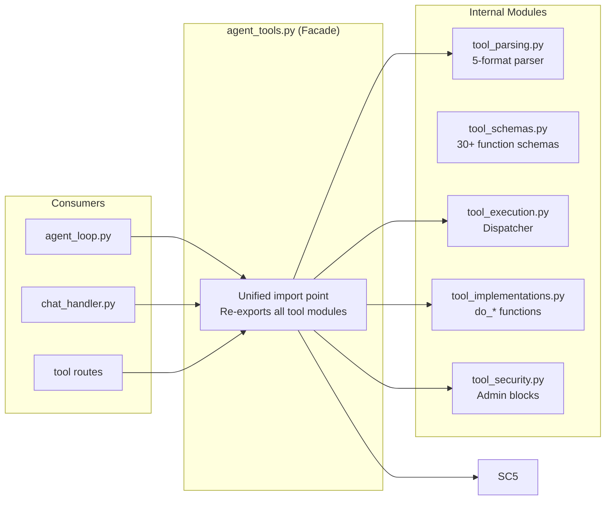

Re-exports from `tool_parsing.py`, `tool_schemas.py`, `tool_execution.py`, and `tool_implementations.py` as a unified facade. Consumers import from `agent_tools` without knowing about the internal modules:

```python
# Consumers don't need to know the module structure
from src.agent_tools import (
    parse_tool_calls,       # From tool_parsing.py
    execute_tool_block,     # From tool_execution.py
    get_tool_schemas,       # From tool_schemas.py
    do_read_file,           # From tool_implementations.py
    blocked_tools_for_owner,# From tool_security.py
)
```

---

## Lazy Initialization

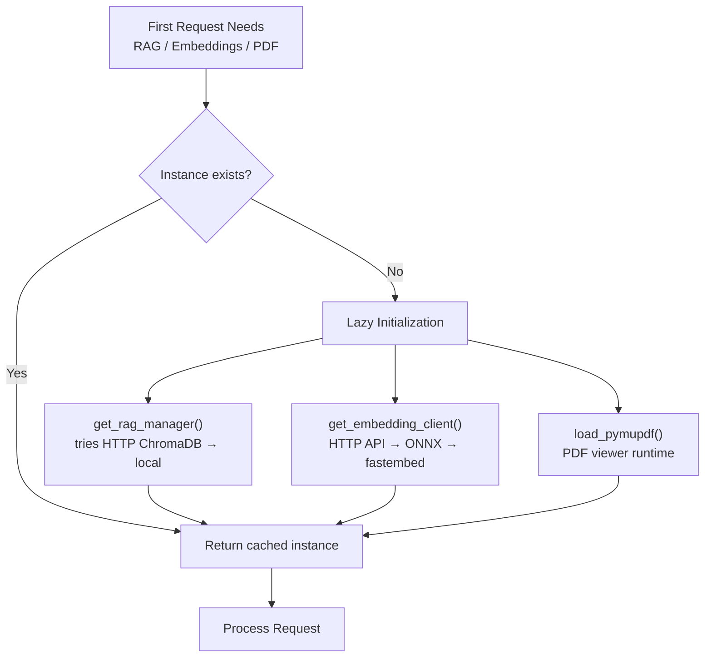

### RAG Manager (`src/rag_singleton.py`)

RAG managers are scoped per user so that one user's document corpus is never visible to another. `get_rag_manager_for_user(user_id)` (`src/rag_singleton.py:63`) lazily builds a `VectorRAG` backed by a ChromaDB collection `ody-rag-{user_id}` and a persistence directory `data/userdata/{user_id}/rag`.

```python
def get_rag_manager_for_user(user_id):
    # 1. Resolve the per-user data dir → data/userdata/{user_id}/rag
    # 2. Lazy init a VectorRAG manager bound to that dir
    # 3. Return cached instance on subsequent calls
```

`get_rag_manager()` (`src/rag_singleton.py:125`) is a backward-compatible alias that delegates to `get_rag_manager_for_user(user_id=None)`.

Benefits:
- Reduces startup time (ChromaDB connection is deferred)
- Per-user isolation enforced at the collection level
- Graceful degradation (falls back through backends)

### Embedding Client (`src/embeddings.py`)

```python
_embedding_client = None

def get_embedding_client():
    """Tries HTTP API first, falls back through ONNX → fastembed."""
    global _embedding_client
    if _embedding_client is None:
        _embedding_client = _create_embedding_client()
    return _embedding_client

def _create_embedding_client():
    """Fallback chain: HTTP → ONNX → fastembed."""
    if EMBEDDING_URL:
        return HTTPEmbeddingClient(EMBEDDING_URL, EMBEDDING_MODEL)
    try:
        return ONNXEmbeddingClient()
    except ImportError:
        return FastembedClient()
```

### PDF Runtime (`src/pdf_runtime.py`)

```python
_pymupdf = None

def load_pymupdf_for_pdf_viewer():
    """Loaded on-first PDF render. PyMuPDF is a heavy import."""
    global _pymupdf
    if _pymupdf is None:
        import fitz  # heavy import deferred
        _pymupdf = fitz
    return _pymupdf
```

---

## Event-Driven Architecture

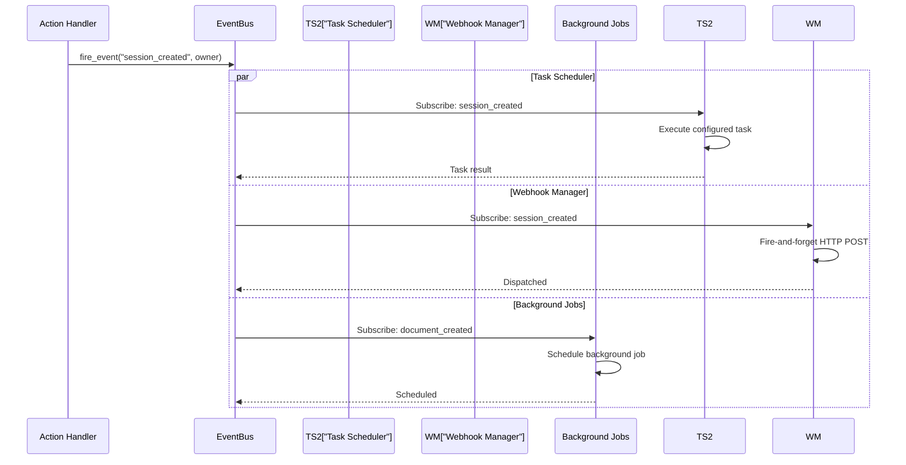

### EventBus (`src/event_bus.py`)

`src/event_bus.py` is **not** a generic in-process pub/sub — there is no subscriber callback list. It is a DB-driven task trigger. Module-level `fire_event(event_name, owner)` (`src/event_bus.py:31`) schedules `_handle_event(...)` on the running loop. `_handle_event` queries the DB for `ScheduledTask` rows whose `trigger_event` matches the fired event, increments each task's `trigger_counter`, and — once the counter reaches the task's configured `trigger_count` threshold — calls `_task_scheduler.run_task_now(task.id)`.

```python
# src/event_bus.py
def fire_event(event_name: str, owner: Optional[str] = None):
    try:
        loop = asyncio.get_running_loop()
        loop.create_task(_handle_event(event_name, owner))
    except RuntimeError:
        asyncio.run(_handle_event(event_name, owner))
```

`fire_event` is safe to call from sync routes (running in the FastAPI threadpool) and from async routes (running on the event loop). Events published by route handlers:

| Event | Triggered When | Data Payload |
|---|---|---|
| `session_created` | New chat session | `{"sid": "...", "owner": "..."}` |
| `message_sent` | Message sent to LLM | `{"sid": "...", "message": {...}}` |
| `document_created` | New document created | `{"doc_id": "...", "owner": "..."}` |
| `memory_added` | Memory entry added | `{"memory_id": "...", "content": "..."}` |

Owner-less events resolve to the first admin user (`_resolve_event_owner`, `src/event_bus.py:44-69`) — this avoids the previous behaviour where app-level events fired every user's tasks once per account.

### Background Job Monitor (`bg_monitor`)

Watches for background bash (`#!bg`) subprocess completion. When a job finishes, it reinjects the output into the agent loop via the session manager:

```python
async def bg_monitor_loop():
    while True:
        for job in active_bg_jobs:
            if job.process.poll() is not None:
                output = job.process.stdout.read()
                await reinject_output(job.sid, output)
                active_bg_jobs.remove(job)
        await asyncio.sleep(1)
```

### Webhook Manager (`src/webhook_manager.py`)

Reacts to events and dispatches HTTP POSTs to configured endpoints:

- `session.created`
- `message.sent`
- Research completion
- Custom events

Webhooks include HMAC signature headers for receiver verification:

```python
async def dispatch_webhook(url: str, event: str, payload: dict):
    body = json.dumps({
        "event": event,
        "data": payload,
        "timestamp": datetime.utcnow().isoformat(),
    })
    signature = hmac.new(SECRET.encode(), body.encode(), "sha256").hexdigest()
    await httpx.AsyncClient().post(url, content=body, headers={
        "X-VHTNA-Event": event,
        "X-VHTNA-Signature": signature,
        "User-Agent": "VHTNA-Webhook",
    })
```

---

## In-Memory Caching with Invalidation

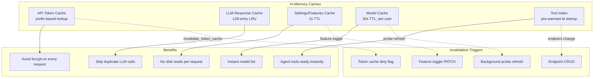

### Cache Details

| Cache | TTL | Invalidation | Purpose |
|---|---|---|---|
| API Token | dirty flag | explicit `invalidate_token_cache()` | Avoid bcrypt on every request |
| LLM Response | 128-entry LRU | N/A (implicit eviction) | Skip duplicate LLM calls |
| Settings/Features | 2s | on write | No disk reads per request |
| Model List | 30s, per-user | background refresh | Instant model picker |
| Tool Index | pre-warm | endpoint CRUD | Agent tools ready instantly |

### API Token Cache

```python
_token_cache: dict[str, CachedToken] = {}
_token_cache_dirty = False

def get_cached_token(prefix: str) -> CachedToken | None:
    if _token_cache_dirty:
        _token_cache.clear()
        _token_cache_dirty = False
    return _token_cache.get(prefix)

def set_cached_token(prefix: str, token: CachedToken):
    _token_cache[prefix] = token

def invalidate_token_cache():
    global _token_cache_dirty
    _token_cache_dirty = True
```

### LLM Response Cache

```python
from functools import lru_cache

@lru_cache(maxsize=128)
def cached_llm_call(messages_hash: str, **params):
    # Only used for non-streaming, idempotent calls
    ...
```

---

## Dead-Host Cooldown

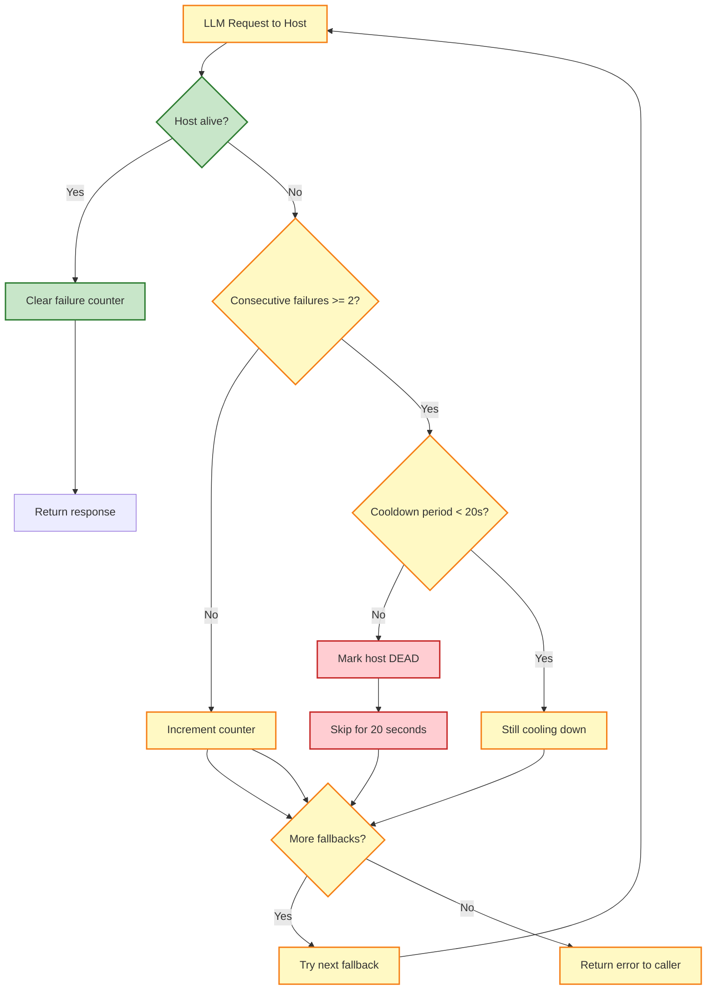

- Tracks consecutive failures per LLM host via in-memory dict
- Only marks hosts dead after threshold (2 consecutive failures)
- 20-second cooldown before retrying dead hosts
- Used in `llm_call_with_fallback()` and `stream_llm_with_fallback()`

```python
# src/llm_core.py:144-153 — failure tracking guarded by a Lock
DEAD_HOST_COOLDOWN = 20.0
_HOST_FAIL_THRESHOLD = 2
_dead_hosts: Dict[str, float] = {}
_host_fails: Dict[str, int] = {}
_host_health_lock = threading.Lock()

async def stream_llm_with_fallback(messages, endpoints, **kwargs):
    for endpoint in endpoints:
        if _is_host_dead(endpoint.url):
            continue
        try:
            async for chunk in stream_llm(messages, endpoint, **kwargs):
                yield chunk
            _record_success(endpoint.url)
            return
        except Exception:
            _record_failure(endpoint.url)
    raise LLMServiceError("All endpoints failed")
```

The synchronous `llm_call()` runs inside FastAPI's threadpool (used by sync routes like `/sessions/auto-sort`) while `llm_call_async()` runs on the event loop. Without the lock, the read-modify-write on `_host_fails` lost failure counts under concurrent connect errors (issue #659).

---

## Multi-Tenant Ownership

### Owner Column Pattern

```mermaid
flowchart TD
    REQ["Request with User ID"] --> FIND2["Query DB for resource"]
    FIND --> OWNER2{"Owner matches\ncurrent_user?"]
    OWNER2 -->|Yes| ALLOW["Proceed with request"]
    OWNER2 -->|No| DENY["404 Not Found"]
```

**404-not-403**: Ownership violations return 404 (not found), never 403 (forbidden), to avoid leaking the existence of resources belonging to other users.

### Owner Filter Helper

```python
def owner_filter(query, model, owner):
    """Filter query by owner. NULL-owner rows are shared."""
    return query.filter(
        or_(model.owner == owner, model.owner.is_(None))
    )
```

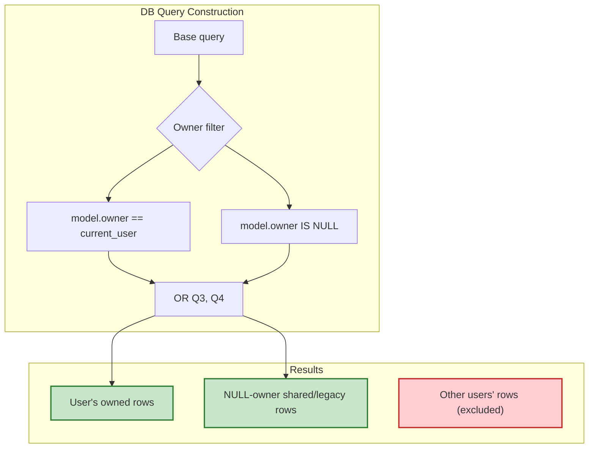

### Legacy Owner Migration

`_migrate_assign_legacy_owner()` runs at startup and hourly:

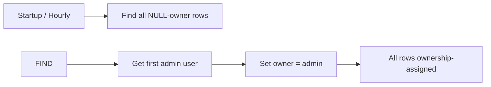

```python
def _migrate_assign_legacy_owner():
    """Assign null-owner rows to first admin user."""
    admin = db.query(User).filter(User.is_admin == True).first()
    if not admin:
        return
    for model in ALL_OWNER_MODELS:
        rows = db.query(model).filter(model.owner.is_(None)).all()
        for row in rows:
            row.owner = admin.username
    db.commit()
```

---

## CSP Nonce Pattern

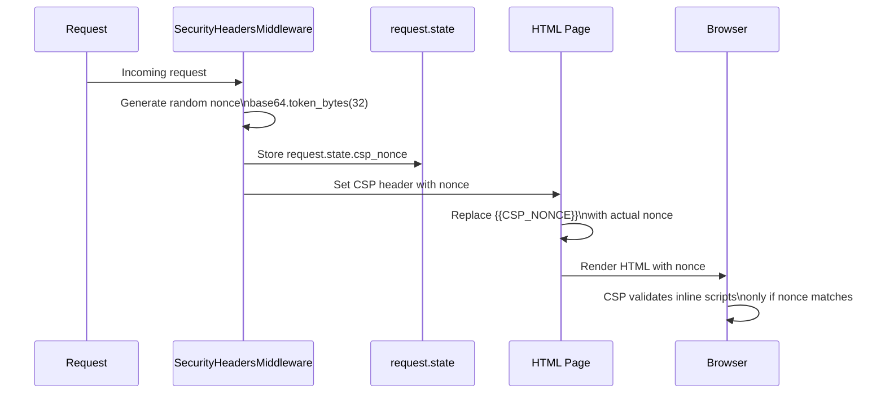

Provides defense-in-depth: CSP blocks inline scripts without a valid nonce, even if XSS vulnerabilities exist.

```python
# core/middleware.py
class SecurityHeadersMiddleware(BaseHTTPMiddleware):
    async def dispatch(self, request, call_next):
        nonce = base64.b64encode(secrets.token_bytes(16)).decode()
        request.state.csp_nonce = nonce
        response = await call_next(request)
        response.headers["Content-Security-Policy"] = (
            f"script-src 'nonce-{nonce}' 'strict-dynamic'"
        )
        response.headers["X-Content-Type-Options"] = "nosniff"
        response.headers["X-Frame-Options"] = "DENY"
        return response
```

---

## Template Method (Route Registration)

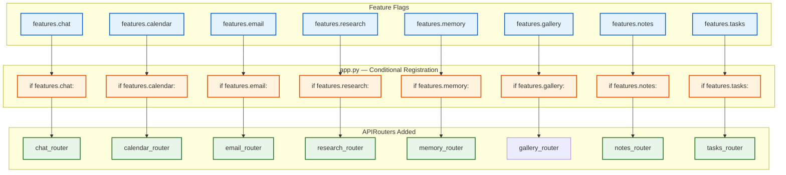

```python
# app.py — conditional route registration
if features.chat:
    app.include_router(setup_chat_routes(...))
if features.calendar:
    app.include_router(setup_calendar_routes(...))
if features.email:
    app.include_router(setup_email_routes(...))
# ... etc.
```

---

## Circuit Breaker (Endpoint Probing)

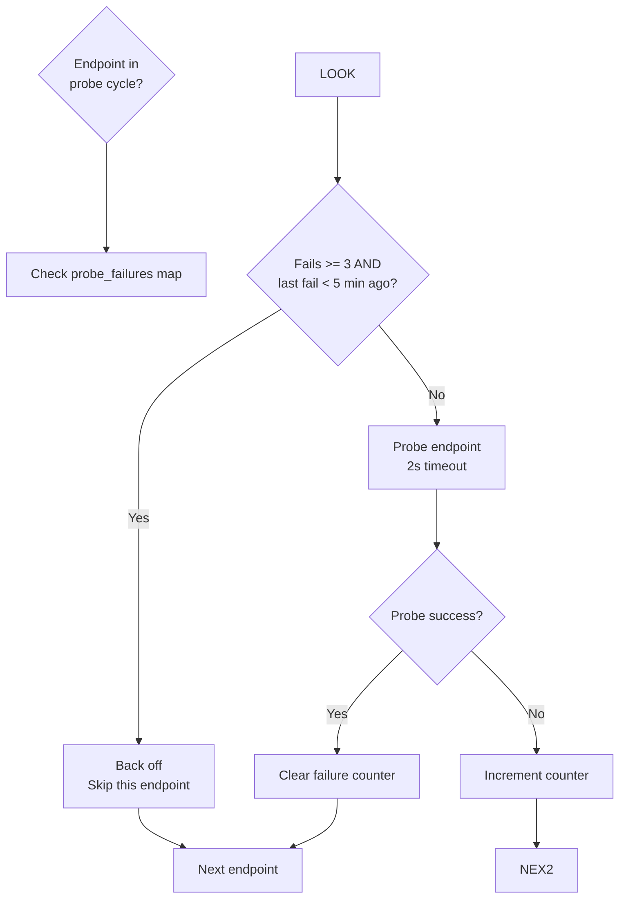

Model endpoint probing uses a failure counter with backoff. Implemented in `model_discovery.py`:

```python
probe_failures: dict[str, int] = {}
last_probe_fail: dict[str, float] = {}

def should_skip_probe(endpoint_id: str) -> bool:
    fails = probe_failures.get(endpoint_id, 0)
    last_fail = last_probe_fail.get(endpoint_id, 0)
    if fails >= 3 and (time.monotonic() - last_fail) < 300:  # 5 min
        return True
    return False
```

---

## Context Management

```mermaid
flowchart TD
    subgraph Budget["context_budget.py"]
        B1["Track token usage\nper round"]
        B2{"Approaching\nbudget limit?"]
    end

    subgraph Compactor["context_compactor.py"]
        COMP["Self-summary compaction"]
        SUM2["Summarize old messages"] --> KEEP["Keep recent\n8 messages verbatim"]
        COMB["Merge summary +\nrecent → new history"]
    end

    subgraph Preface["chat_processor.py\nContext Preface Layers"]
        L1["1. Preset system prompt"]
        L2["2. Prompt safety policy"]
        L3["3. Pinned memories +\nvector/search memories"]
        L4["4. RAG results"]
        L5["5. Web search results"]
        L6["6. URL content"]
        L7["7. Skills index\n(agent mode only)"]
    end

    B1 --> B2
    B2 -->|Yes| COMP
    B2 -->|No| PREFACE
    COMP --> SUMM
    SUM --> KEEP
    KEEP --> COMB

    L1 --> L2 --> L3 --> L4 --> L5 --> L6 --> L7
```

### Context Budget

`src/context_budget.py:21` exposes a pure function `compute_input_token_budget(configured, context_length, explicit, ...)` that returns the effective soft input-token budget:

- Explicit user budget → honoured exactly (clamped to the model's window when known)
- Otherwise → `headroom` (0.85) of the model's discovered context window, capped at `DEFAULT_HARD_MAX = 200_000`
- Unknown window → fall back to the configured/default value (`DEFAULT_BUDGET = 6000`)

```python
# src/context_budget.py
DEFAULT_HARD_MAX = 200_000
DEFAULT_BUDGET = 6000
DEFAULT_HEADROOM = 0.85

def compute_input_token_budget(configured, context_length, explicit, *,
                                default=DEFAULT_BUDGET,
                                headroom=DEFAULT_HEADROOM,
                                hard_max=DEFAULT_HARD_MAX) -> int:
    if explicit and configured > 0:
        return min(configured, context_length) if context_length > 0 else configured
    if context_length > 0:
        return max(1, min(int(context_length * headroom), hard_max))
    return configured if configured > 0 else default
```

### Context Compactor

`src/context_compactor.py` summarizes older conversation history when usage crosses `COMPACT_THRESHOLD = 0.85` (85% of the model's context window). The summary is produced via the same LLM using `SELF_SUMMARY_SYSTEM_PROMPT`, which yields a Cursor-style structured summary: **User Goal**, **What Was Done**, **Current State**, **Pending / Next Steps**, **Key Context**.

```python
# src/context_compactor.py
COMPACT_THRESHOLD = 0.85
SELF_SUMMARY_SYSTEM_PROMPT = """You are summarizing a conversation to preserve context after compaction. ..."""

async def maybe_compact(session, endpoint_url, model, messages, headers=None):
    context_length = get_context_length(endpoint_url, model)
    used = estimate_tokens(messages)
    pct = (used / context_length) * 100 if context_length else 0
    if pct < COMPACT_THRESHOLD * 100:
        return messages, context_length, False
    # split into older / recent halves, summarize older, splice summary into session.history
```

---

## Stream Safety (Partial Save)

```mermaid
sequenceDiagram
    participant CLIENT as Client
    participant ROUTE as route handler
    participant STREAM as _active_streams dict
    participant DB as Database

    ROUTE->>STREAM: Register session\nstatus="streaming"

    loop Stream tokens
        ROUTE->>CLIENT: SSE delta event
        ROUTE->>STREAM: _stream_set(partial=text)
    end

    alt Client disconnect
        CLIENT-x>ROUTE: Connection lost
        ROUTE->>STREAM: Check partial text
        ROUTE->>DB: Save partial response
        ROUTE->>STREAM: Remove session entry
    end

    end

    ROUTE->>STREAM: Remove on [DONE]
```

```python
# Active stream tracking
_active_streams: dict[str, dict] = {}

def _stream_set(sid: str, **kwargs):
    if sid in _active_streams:
        _active_streams[sid].update(kwargs)

def _stream_get(sid: str) -> dict | None:
    return _active_streams.get(sid)

async def on_disconnect(sid: str):
    stream = _stream_get(sid)
    if stream and stream.get("partial"):
        await save_partial_message(sid, stream["partial"])
    _active_streams.pop(sid, None)
```

---

## Provider-Specific Normalization

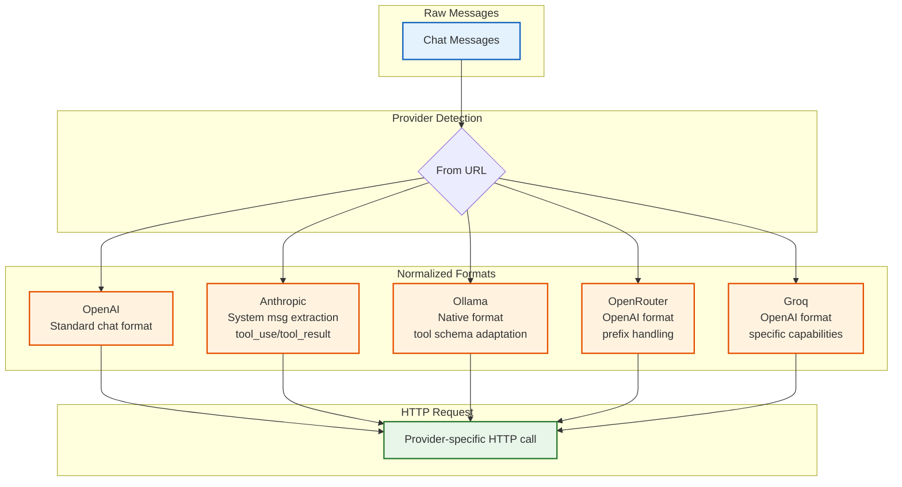

```python
# endpoint_resolver.py — provider detection
def detect_provider(url: str) -> str:
    url_lower = url.lower()
    if "anthropic" in url_lower:
        return "anthropic"
    if "ollama" in url_lower:
        return "ollama"
    if "openrouter" in url_lower:
        return "openrouter"
    if "groq" in url_lower:
        return "groq"
    return "openai"  # default / OpenAI-compatible
```

Each provider has a normalization function in `llm_core.py` that converts the internal message format to the provider's expected wire format.