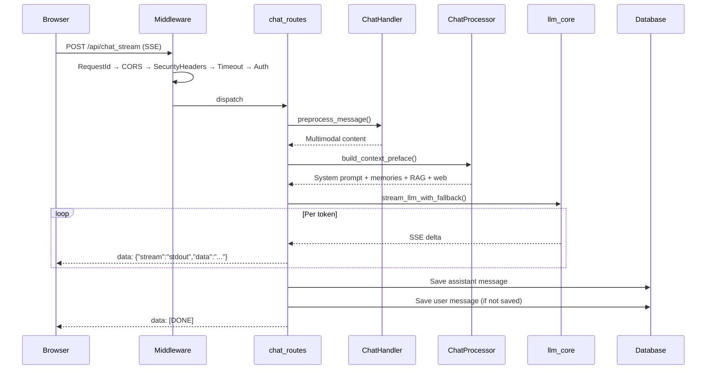
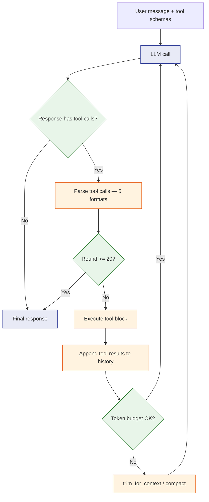
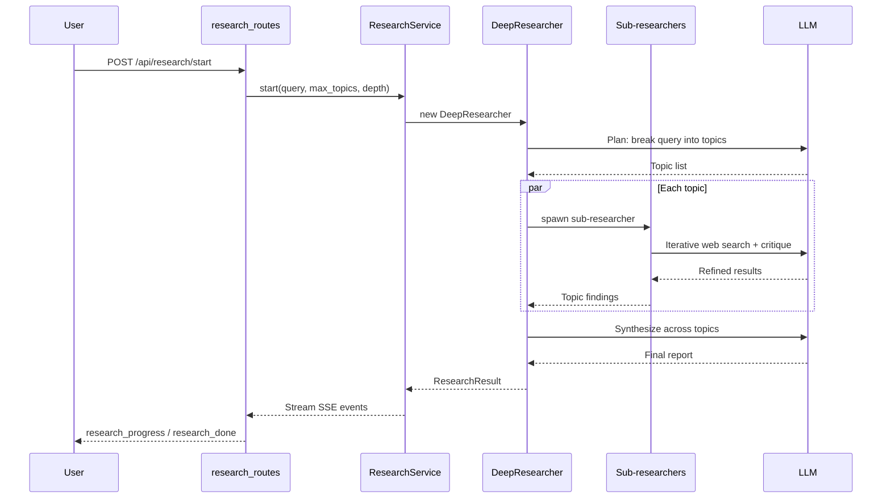
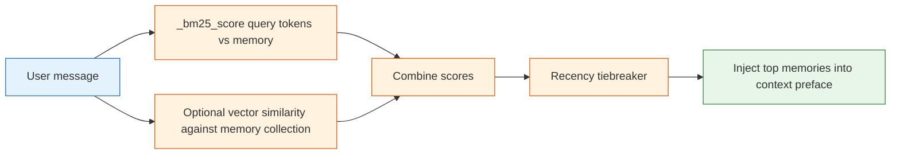
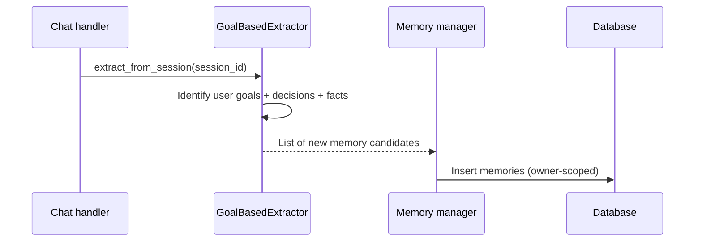
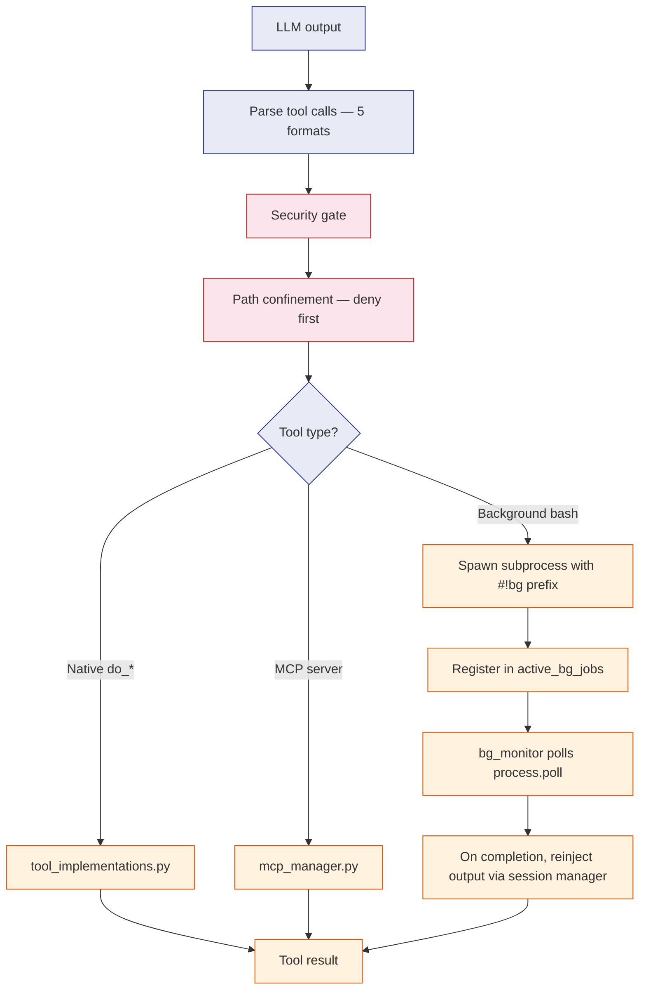
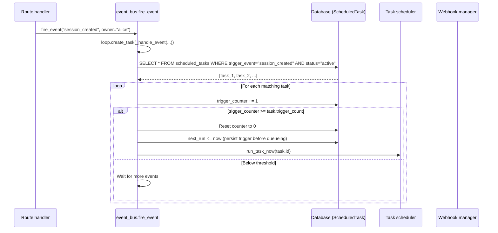
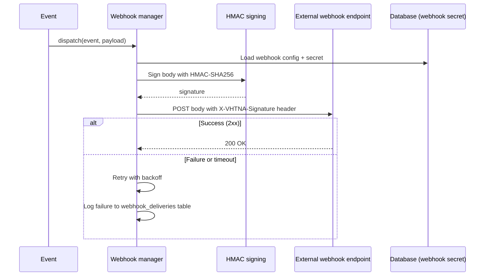
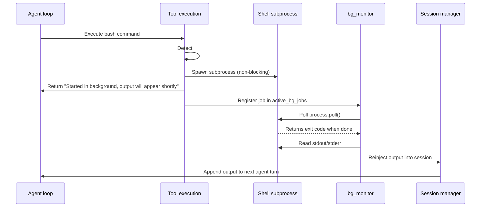
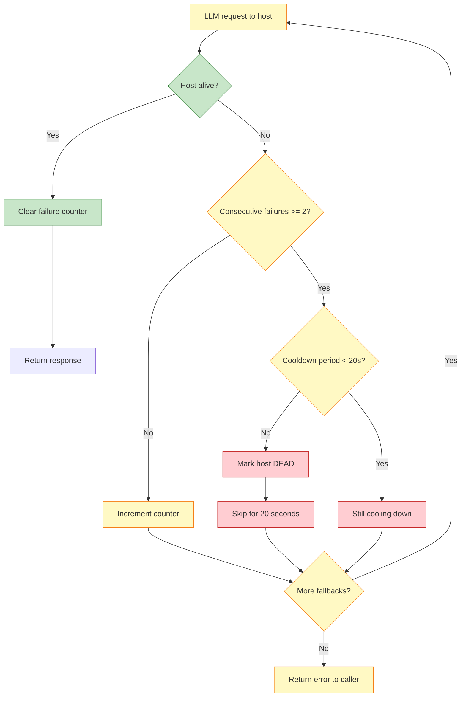

# VHT Network Automation — Workflows

End-to-end workflow traces across the major subsystems. Each section is self-contained: start with the workflow you care about.

## Operator Quickstart

| Workflow | One-liner | Config knobs | Where to look |
|---|---|---|---|
| Chat Send | Browser POST → SSE stream → DB save | `LLM_HOST`, `OPENAI_API_KEY` | `routes/chat_routes.py`, `src/chat_handler.py` |
| Agent Loop | LLM + tool rounds (max 20) | `agent_input_token_budget` | `src/agent_loop.py:1352` |
| Deep Research | Plan → N parallel sub-researchers → synthesize | `MAX_TOPICS`, depth | `services/research/` |
| RAG Retrieval | Per-user ChromaDB → vector search → inject context | `CHROMADB_HOST`, `RAG_SIMILARITY_THRESHOLD=0.35` | `src/chat_processor.py:52`, `src/rag_singleton.py:63` |
| Memory Recall | BM25 keyword + optional vector similarity + recency | — | `src/chat_processor.py:54-118` |
| Tool Execution | Parse → security gate → dispatch (native / MCP / bash) | `tool_path_extra_roots` | `src/tool_execution.py:739` |
| Event Bus → Tasks | Event fires → DB query → `run_task_now` | — | `src/event_bus.py:31-72` |
| Webhook Dispatch | HMAC-SHA256 signed POST | per-webhook `secret` | `src/webhook_manager.py` |
| Background Bash | `#!bg <cmd>` → subprocess → bg_monitor reinjects output | — | `src/bg_monitor.py` |
| Dead-Host Cooldown | 2 consecutive failures → 20s cooldown | `DEAD_HOST_COOLDOWN`, `_HOST_FAIL_THRESHOLD` | `src/llm_core.py:144-153` |

---

## 1. Chat Send Workflow (golden path)



**Key file:line references:**
- `routes/chat_routes.py` — SSE endpoint that streams tokens
- `src/chat_handler.py:32` — `ChatHandler` class orchestrating per-message work
- `src/chat_processor.py:44` — `ChatProcessor.build_context_preface()` assembles memory + RAG + web layers
- `src/llm_core.py` — `stream_llm_with_fallback()` with dead-host cooldown

**Background tasks kicked off after stream:**
- Memory extraction (`src/goal_based_extractor.py`)
- Session auto-name if title is still "New Chat"

---

## 2. Agent Loop Turn Lifecycle



**Per-turn steps:**
1. Retrieve session history
2. Build context (system prompt + memories + RAG + skills)
3. Soft-trim input to `agent_input_token_budget` (default 6000, scaled to model window × 0.85, capped at 200K)
4. Call LLM
5. Parse tool calls (5 formats: fenced code blocks, `[TOOL_CALL]`, XML `<invoke>`, `<tool_code>` (MiniMax), DeepSeek DSML)
6. Execute each tool block via `src/tool_execution.py:739`
7. Append tool results
8. Check budget → if over, compact via `maybe_compact` or trim via `trim_for_context`
9. Continue until no more tool calls or max rounds hit

**Key file:line references:**
- `src/agent_loop.py:1352` — `stream_agent_loop` entry point
- `src/agent_loop.py:389` — `_assemble_prompt` builds the tool-use system prompt
- `src/tool_parsing.py:338` — `parse_tool_blocks` handles 5 LLM output formats
- `src/tool_execution.py:739` — `execute_tool_block` dispatcher with security gate
- `src/context_compactor.py:147` — `trim_for_context` drops RAG/memory system messages before conversation turns
- `src/context_budget.py:21` — `compute_input_token_budget` pure function

---

## 3. Deep Research Flow



**Lifecycle:**
1. **Plan** — LLM breaks the query into N sub-topics
2. **Spawn parallel sub-researchers** — each does iterative web search → critique → refine
3. **Synthesize** — LLM combines findings across topics
4. **Emit SSE events** — `research_progress` (stage + 0.0-1.0 progress), `research_done` (title + summary)
5. **Cache result** as JSON in `data/deep_research/`

**Key file:line references:**
- `services/research/service.py` — `ResearchService` / `ResearchResult` / `ResearchSource`
- `services/research/research_handler.py` — handler with expandable UI support, uses IterResearch-style DeepResearcher
- `routes/research_routes.py` — SSE streaming endpoints

**Cancellation:** `POST /api/research/cancel/{sid}` sets a cancellation flag that the sub-researcher loop checks between iterations.

**Result access:** `GET /api/research/result/{sid}` returns cached result (clears cache). `POST /api/research/result-peek/{sid}` returns without clearing.

---

## 4. RAG Retrieval Pipeline

```mermaid
flowchart TD
    Q[User query] --> EMB[Embed query via src/embeddings.py]
    EMB --> CH[Per-user ChromaDB collection ody-rag-{user_id}]
    CH --> SIM[Compute cosine similarity]
    SIM --> FILT{similarity >= 0.35?}
    FILT -->|No| DROP[Drop chunk]
    FILT -->|Yes| KEEP[Inject as untrusted system context]

    classDef query fill:#e3f2fd,stroke:#1565c0
    classDef proc fill:#fff3e0,stroke:#e65100
    classDef decision fill:#e8f5e9,stroke:#2e7d32
    class Q,EMB query
    class CH,SIM,KEEP,DROP proc
    class FILT decision
```

**Per-user isolation:**
- RAG managers are scoped per user via `get_rag_manager_for_user(user_id)` at `src/rag_singleton.py:63`
- Each user's documents live in `data/userdata/{user_id}/rag/`
- ChromaDB collection name: `ody-rag-{user_id}`
- One user's document corpus is never visible to another user

**Retrieval pipeline:**
1. Embed user query using `src/embeddings.py` (HTTP API → ONNX → fastembed fallback chain)
2. Query per-user ChromaDB collection for top-K chunks
3. Filter chunks where `similarity < RAG_SIMILARITY_THRESHOLD = 0.35` (`src/chat_processor.py:52`)
4. Inject surviving chunks as untrusted system context via `untrusted_context_message()`

**Key file:line references:**
- `src/chat_processor.py:52` — `RAG_SIMILARITY_THRESHOLD = 0.35`
- `src/chat_processor.py:159` — `build_context_preface` assembles layers
- `src/rag_singleton.py:63` — `get_rag_manager_for_user(user_id)`
- `src/embeddings.py` — embedding client with fallback chain
- `src/chroma_client.py` — ChromaDB HTTP client wrapper

---

## 5. Memory Extraction & Recall

### Recall (during chat send)



Memory recall uses a hybrid scoring scheme (`src/chat_processor.py:54-118`):
- **BM25-inspired keyword score** (`_bm25_score(query_toks, mem_id)`)
- **Optional vector similarity** against the user's memory collection
- **Recency tiebreaker** — newer memories win ties

### Extraction (after chat completes)



The goal-based extractor (`src/goal_based_extractor.py`) mines completed chat sessions for:
- User goals and preferences
- Decisions made
- Facts worth remembering
- Tasks and action items

**Key file:line references:**
- `src/chat_processor.py:54` — `_hybrid_retrieve` (BM25 + vector + recency)
- `src/chat_processor.py:82` — `_bm25_score` implementation
- `src/goal_based_extractor.py` — goal-based memory extraction
- `src/memory.py` — keyword-based persistent memory manager
- `src/memory_vector.py` — ChromaDB vector memory

---

## 6. Tool Execution Pipeline



**Five parsing formats** (`src/tool_parsing.py:338`):
1. Fenced code blocks — ` ```tool_name(args) `
2. `[TOOL_CALL]` blocks
3. XML `<invoke>` blocks
4. `<tool_code>` blocks (MiniMax-M2.5 style)
5. DeepSeek DSML markup (normalized to `<invoke>` first)

**Security gate** (`src/tool_execution.py`):
- Admin-only tool blocks for non-admin users
- Path confinement uses a **deny-first** policy: sensitive paths (`.ssh`, `.gnupg`, `.aws`, `.git`, `*.pem`, `*.key`, `id_rsa*`, `authorized_keys*`, `.bashrc`, `.bash_profile`, `.zshrc`, `.profile`) rejected *before* allowlist
- Configurable extra roots via `tool_path_extra_roots` setting
- Incognito mode blocks `manage_memory`, `search_chats`, `manage_skills`

**Dispatch targets:**
- **Native `do_*`** in `src/tool_implementations.py` (30+ implementations: doc CRUD, notes, calendar, email, bash, python, etc.)
- **MCP servers** via `src/mcp_manager.py` (stdio, SSE, HTTP transports)
- **Background bash** via `#!bg` prefix + `src/bg_monitor.py` polling

**Key file:line references:**
- `src/tool_execution.py:739` — `execute_tool_block` dispatcher
- `src/tool_parsing.py:338` — `parse_tool_blocks` 5-format parser
- `src/tool_implementations.py` — 30+ native `do_*` functions
- `src/mcp_manager.py` — MCP server lifecycle and tool listing
- `src/bg_monitor.py` — background bash polling loop

---

## 7. Event Bus → Scheduled Task Trigger Flow



**Event bus is NOT a generic in-process pub/sub** — there is no subscriber callback list. It is a DB-driven task trigger.

**Module-level function** at `src/event_bus.py:31`:
```python
def fire_event(event_name: str, owner: Optional[str] = None):
    try:
        loop = asyncio.get_running_loop()
        loop.create_task(_handle_event(event_name, owner))
    except RuntimeError:
        asyncio.run(_handle_event(event_name, owner))
```

**Owner resolution** (`src/event_bus.py:44-69`):
- Owner-less events resolve to the first admin user via `_resolve_event_owner`
- This avoids the previous behaviour where app-level events fired every user's tasks once per account

**Key file:line references:**
- `src/event_bus.py:31` — `fire_event` entry point
- `src/event_bus.py:44-69` — `_resolve_event_owner`
- `src/event_bus.py:72-126` — `_handle_event` queries DB for matching `ScheduledTask` rows
- `src/task_scheduler.py` — `run_task_now` dispatches the task

---

## 8. Webhook Dispatch Flow



**HMAC signing:**
- Body: `{"event": "...", "data": {...}, "timestamp": "..."}`
- Signature: `hmac.new(SECRET.encode(), body.encode(), "sha256").hexdigest()`
- Headers: `X-VHTNA-Event`, `X-VHTNA-Signature`, `User-Agent: VHTNA-Webhook`

**Retry policy:**
- Configurable retry count and backoff
- Failed deliveries logged for diagnostics

**Key file:line references:**
- `src/webhook_manager.py` — outbound HTTP POST dispatch with HMAC signing
- `routes/webhook_routes.py` — webhook CRUD endpoints
- `core/database.py` — `Webhook` model with secret column

---

## 9. Background Bash Reinjection



**Lifecycle:**
1. Agent emits a bash tool call prefixed with `#!bg`
2. Tool execution spawns the subprocess non-blocking
3. Returns immediately with a "started in background" message
4. Registers the job in `active_bg_jobs`
5. `bg_monitor` polls `process.poll()` for each active job
6. On completion, reads stdout/stderr and reinjects into the agent loop via the session manager

**Key file:line references:**
- `src/bg_monitor.py` — polls background bash subprocesses
- `src/tool_execution.py` — detects `#!bg` prefix and spawns background subprocess
- `src/session_manager.py` — session manager that reinjects output

---

## 10. Dead-Host Cooldown Flow (LLM endpoints)



**Implementation** at `src/llm_core.py:144-153`:
```python
DEAD_HOST_COOLDOWN = 20.0
_HOST_FAIL_THRESHOLD = 2
_dead_hosts: Dict[str, float] = {}
_host_fails: Dict[str, int] = {}
_host_health_lock = threading.Lock()
```

**Why the Lock?**
The synchronous `llm_call()` runs inside FastAPI's threadpool (used by sync routes like `/sessions/auto-sort`) while `llm_call_async()` runs on the event loop. Without the lock, the read-modify-write on `_host_fails` lost failure counts under concurrent connect errors (issue #659).

**Recovery:**
Any successful response resets the failure counter immediately — so a transient blip (local model briefly busy, Tailscale hiccup) doesn't trip a full 60s lockout.

**Key file:line references:**
- `src/llm_core.py:144-153` — cooldown constants and lock-guarded failure tracker
- `src/llm_core.py` — `_is_host_dead`, `_mark_host_dead`, `_record_success`, `_record_failure`

---

## See Also

- [01-system-overview.md](01-system-overview.md) — High-level architecture and tech stack
- [02-architecture.md](02-architecture.md) — Layered design, request flow, agent loop
- [03-design-patterns.md](03-design-patterns.md) — Singleton, factory, facade, lazy init, event-driven
- [04-api-reference.md](04-api-reference.md) — Complete endpoint catalog
- [05-security-auth.md](05-security-auth.md) — Auth, multi-tenant isolation, tool security
