# nc_v7 monolith architecture baseline — before refactor

> **Baseline date:** 2026-09-14  
> **Status:** current-state report captured before the proposed network-focused
> refactor  
> **Preservation rule:** keep this file unchanged after refactor begins. Record
> the new implementation in a separate post-refactor report and compare it
> against this baseline.

This document describes what the standalone `nc_v7_monolith` source does now,
not the desired end-state. It exists because the older architecture documents
also describe broad Odysseus capabilities and contain some historical details
that are no longer true for the current network-change build.

Related documents:

- [`ARCHITECTURE.md`](ARCHITECTURE.md) — detailed base-application internals.
- [`02-architecture.md`](02-architecture.md) — broad Odysseus component map.
- [`06-workflows.md`](06-workflows.md) — broad workflow catalogue.
- [`NETWORK_CHANGE_MONOLITH.md`](NETWORK_CHANGE_MONOLITH.md) — intentional
  network-change boundaries.
- [`STORAGE.md`](STORAGE.md) — relational, vector, and object storage.
- [`AGENT_HANDOFF.md`](AGENT_HANDOFF.md) — implementation handoff.

## 1. Executive summary

`nc_v7_monolith` is one FastAPI application serving one browser SPA and one
general-purpose tool-using agent loop. It is not a deployment of separate
planner, triage, and executor agents. The model selected in the active chat is
the lead reasoning process.

The source combines:

- The existing Odysseus frontend and general productivity routes.
- Model endpoint registration, discovery, selection, and fallback.
- Session and chat history persistence.
- A bounded agent loop with built-in and MCP tools.
- Knowledge ingestion and retrieval through Qdrant.
- Editable, versioned documents and browser exports.
- Dynamic MCP server registration and discovery.
- Five in-process network-change tools for evidence snapshots, structural
  comparison, static validation, proposal preparation, and history.

The current network-change capability is an **evidence and static-preflight
workspace**, not a Kubernetes sandbox. The application does not execute a
generated change, create a test namespace, run Kubernetes server-side dry-run,
or simulate controllers, pods, nodes, CNI, or traffic behavior.

## 2. Fixed architecture decisions at this baseline

1. One deployable FastAPI monolith.
2. One lead agent loop per active chat request.
3. Kubernetes/network live state is obtained through externally configured MCP
   servers; the application has no Kubernetes client and does not read
   kubeconfig or invoke `kubectl` for domain operations.
4. The currently expected Kubernetes MCP is read-only.
5. Network-change artifacts are proposals for human review and always return
   `execution_allowed=false`.
6. No ACE, self-evolution, automatic policy mutation, Batfish, digital twin,
   automatic repair executor, or automatic rollback is present.
7. A structured staged plan is required for a persisted network-change
   proposal; ordinary questions and file/report requests remain dynamic agent
   tasks.
8. PostgreSQL/Qdrant container topology is not part of the planned refactor.
   Uvicorn connects to the backends selected by environment variables.

## 3. System context

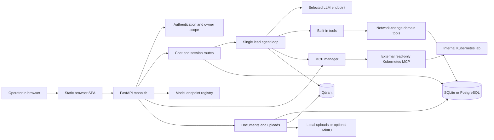

The arrows to the Kubernetes lab are read-only at this baseline. No path from
`NetTools` performs a cluster mutation.

## 4. Component architecture

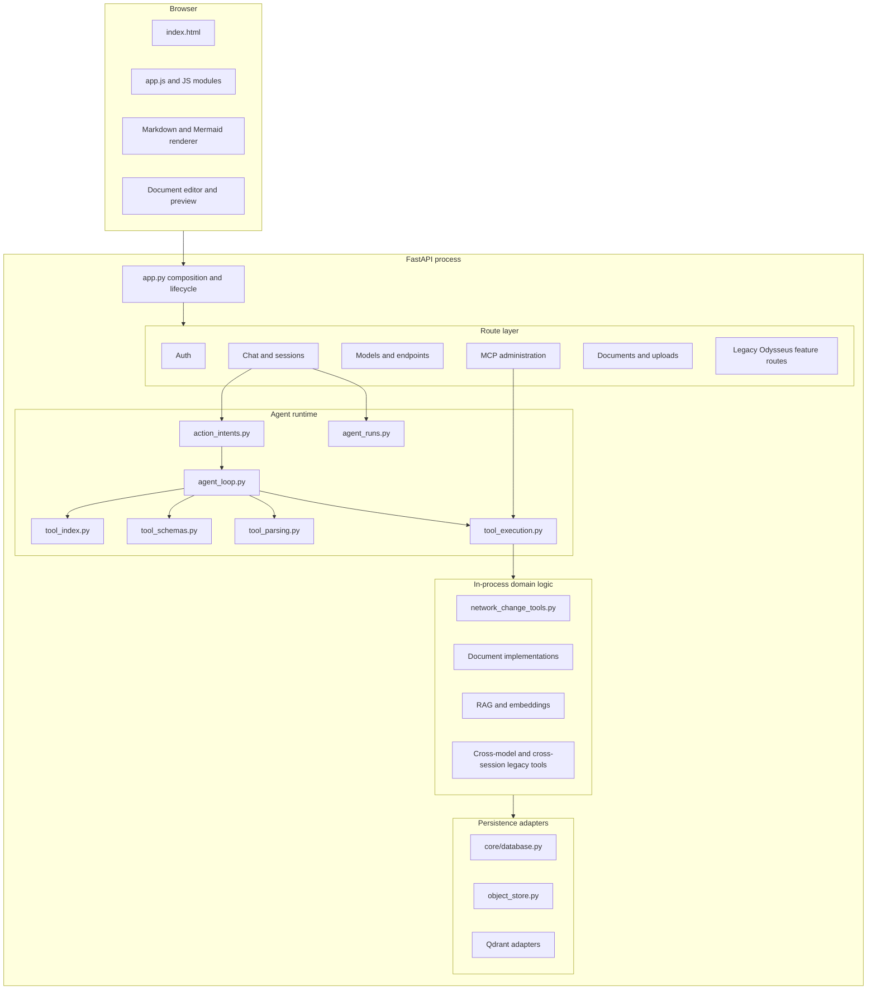

## 5. Runtime and deployment boundaries

Running:

```bash
python3 -m uvicorn app:app --host 0.0.0.0 --port 7000
```

starts only the FastAPI Python process. It does not build Docker images or
start PostgreSQL or Qdrant.

Current backend selection:

| Concern | Default/direct-Uvicorn behavior | Optional deployment behavior |
|---|---|---|
| Relational data | `sqlite:///./data/app.db` | Existing external PostgreSQL from `DATABASE_URL` |
| Vector data | Existing Qdrant from `QDRANT_URL` | Same; this source does not need a new Qdrant image |
| Editable document body | SQL `documents` and `document_versions` | Best-effort MinIO mirror when enabled |
| Upload blob | `data/uploads/` | MinIO/S3 when enabled |
| Agent-run replay | Process RAM | Not restart-durable |
| User tool workspace | `data/userdata/<owner>/` | May be synchronized from MinIO |

The source archive intentionally does not contain runtime databases, sessions,
credentials, uploads, or generated reports.

## 6. Startup sequence

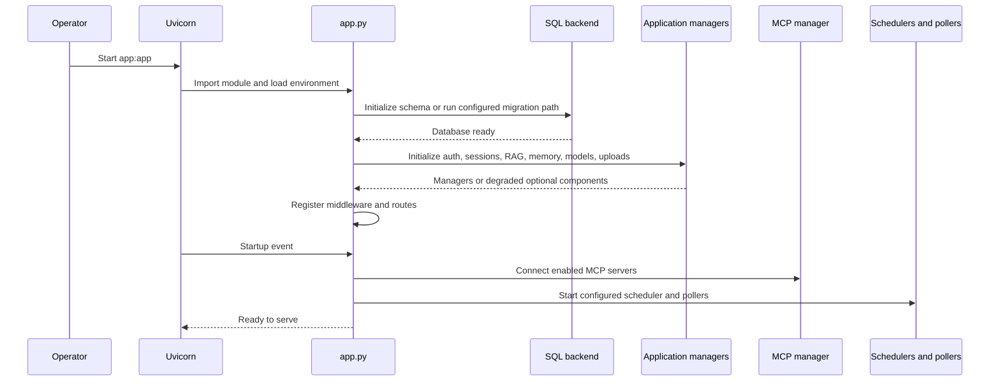

Optional services can degrade independently, but failure of critical database
or application initialization can prevent readiness.

## 7. Model endpoint selection sequence

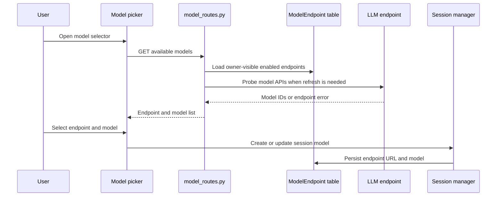

The selected session model is the lead model. Utility, teacher, task, and
fallback models are optional supporting calls, not separately deployed agents.

## 8. Chat-only versus agent-mode sequence

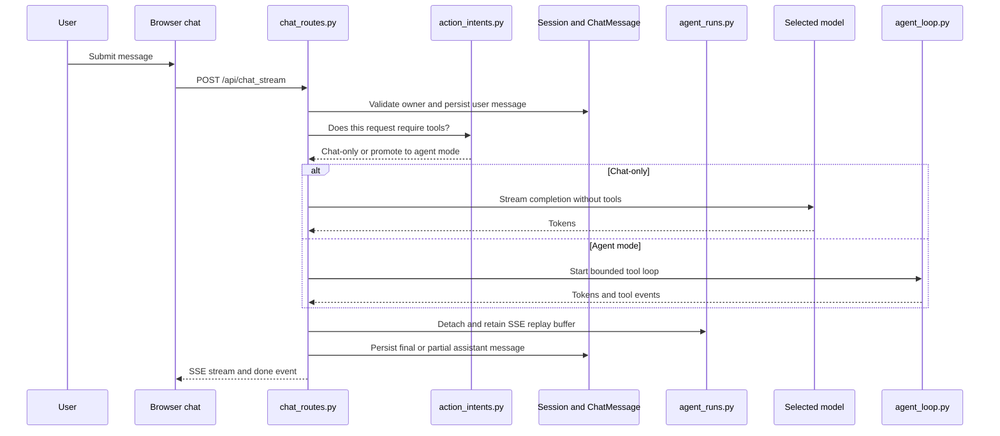

`agent_runs.py` keeps the stream alive across browser refresh/disconnect, but
its replay buffer lives only in process memory and is evicted after completion.

## 9. Tool selection and execution sequence

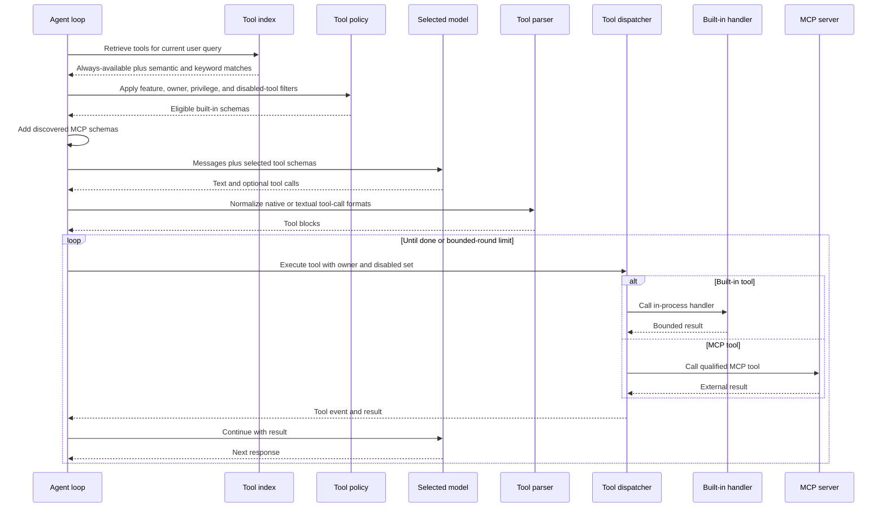

Current limitation: semantic relevance primarily narrows built-in tools. MCP
schemas are discovered dynamically and can still add substantial context.
Built-in tool metadata is also duplicated across multiple registries and the
frontend.

## 10. MCP server lifecycle

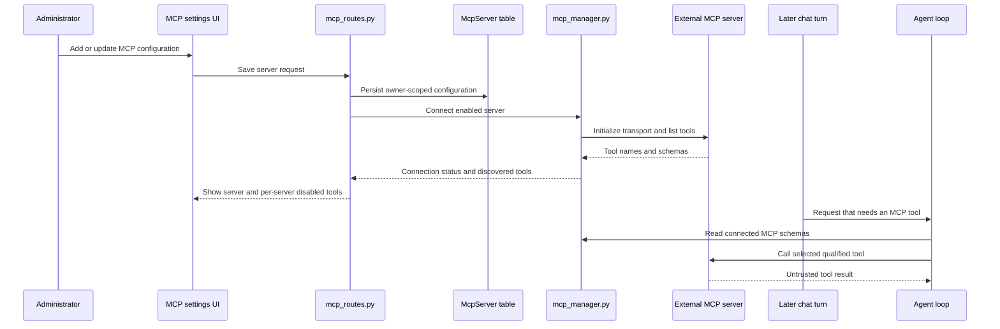

The current frontend has MCP administration and per-server disabled-tool storage; it does
not yet provide the proposed per-session `Disabled / Auto / Pinned` selector
for every built-in and MCP tool.

## 11. Network-change proposal sequence

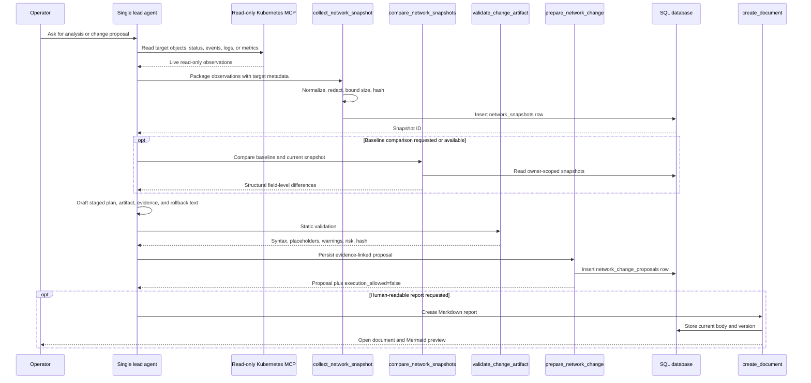

The agent must call MCP first. The in-process network tools neither connect to
MCP internally nor acquire cluster credentials.

## 12. What static artifact validation currently verifies

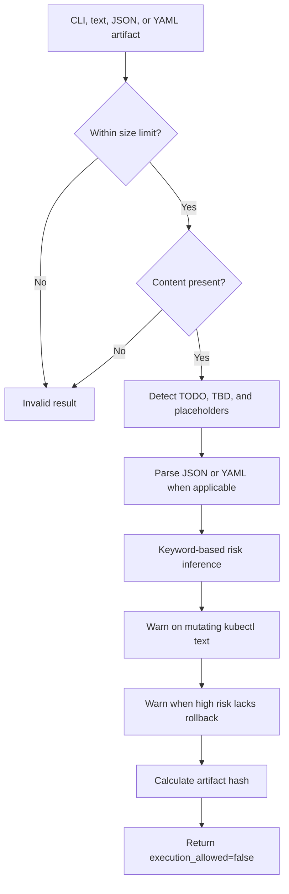

For `format=cli`, validation is currently text-oriented. It does not build an
AST for the command, resolve all resource selectors, contact the Kubernetes API
for server-side dry-run, or run the command in a rehearsal environment.

## 13. Knowledge ingestion and retrieval

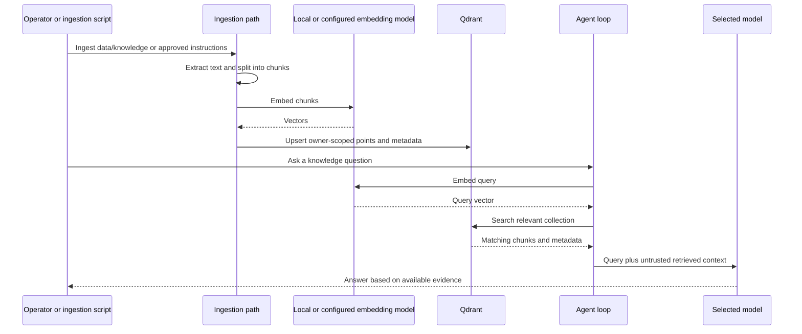

Qdrant stores vectors and payload metadata. It is not the canonical store for
chat messages or editable document version history.

## 14. Document generation, persistence, and export

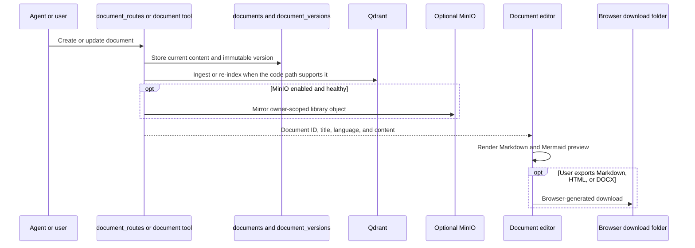

At this baseline, an AI-created Markdown document can exist only as SQL rows
plus an optional MinIO object. It is not guaranteed to exist as a readable
`.md` file under `data/userdata/<owner>/`.

## 15. Session and chat-history persistence

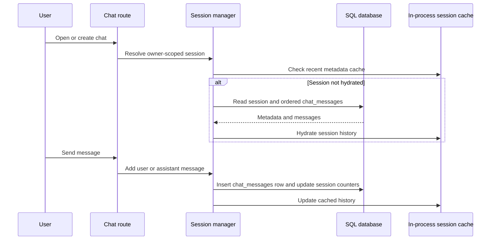

`data/sessions.json` remains only as a compatibility constant. The current
session manager persists chat history in SQL. The `data/userdata/<owner>/`
directory is a file workspace/object-store mirror, not the chat database.

## 16. Legacy cross-model and cross-session capabilities

These functions remain registered from Odysseus but are not required by the
core network-change flow:

| Capability | Current behavior | Baseline concern |
|---|---|---|
| `chat_with_model` | One supporting LLM call to a selected model | Useful as LLM-as-a-tool; retain |
| `create_session` | Creates another persisted chat with a chosen model | Does not create another service; can remain on explicit intent |
| `send_to_session` | Calls the target session model with its history and stores the result | Needs an explicit owner-scope review before broad use |
| Generic `pipeline` | Sequential model calls; previous output feeds the next instruction | Not a network-change stage runner and has no evidence/policy contract |
| Personal assistant/CrewMember | Persona, model, enabled tools, session, scheduled check-ins | Legacy assistant abstraction; not part of the chosen single-lead architecture |

The presence of these utilities does not make ordinary chat a multi-agent
system. They become orchestration only when explicitly selected or invoked.

## 17. Security and isolation boundaries

### Owner scope

Sessions, documents, model endpoints, MCP configurations, memories, snapshots,
and proposals are intended to be owner-scoped. Administrator visibility is a
deliberate exception in parts of the relational route layer.

### Tool restrictions

Tool eligibility is constrained by feature flags, per-user privileges, global
disabled settings, request toggles, and execution-time checks. The current UI
does not yet expose the proposed session-level tri-state selector.

### File paths

The native `read_file` and `write_file` handlers resolve symlinks, deny known
sensitive paths, and restrict access to configured roots. This confinement does
not turn unrestricted `bash` or `python` subprocesses into a strong sandbox.

### HTML preview

HTML document preview runs in a browser iframe with sandbox attributes. That
browser isolation is unrelated to Kubernetes change rehearsal.

### Kubernetes

The current safety boundary is architectural absence: domain tools have no
cluster mutation implementation and proposals always say execution is not
allowed. There is no Kubernetes sandbox at this baseline.

## 18. Current route capability groups

### Network-change core or directly supporting

- Authentication and owner context.
- Chat, session, and history.
- Models/endpoints and embeddings.
- MCP server administration and invocation.
- Knowledge/RAG and uploads.
- Documents, versions, preview, and export.
- Network snapshot, comparison, validation, proposal, and history tools.
- Preferences, health/readiness, backup, and cleanup support.

### Potentially useful but optional for the focused product

- Manual memory and approved skills/instructions.
- Scheduled tasks and webhooks.
- External research/search.
- Presets.
- `chat_with_model` as an LLM tool.
- Session creation and management on explicit user intent.

### Broad Odysseus capabilities still present

- Email, calendar, contacts, personal notes, signatures.
- Gallery and image editing.
- Text-to-speech and speech-to-text.
- Cookbook, hardware fitting, and local model-serving controls.
- Generic model comparison and deep research.
- Personal assistant/CrewMember.
- Generic shell, Python, internal API, and cross-session utilities.

The baseline records their presence; it does not prescribe deleting all of
them. The refactor should first hide or disable features by profile, collect
usage evidence, and remove code only after dependency checks.

## 19. What is missing or needs to be updated

This section is the explicit pre-refactor gap register. Update progress in a
new post-refactor report; do not overwrite the baseline status here.

| Priority | Missing or inconsistent behavior at baseline | Required update or decision | Acceptance evidence after refactor |
|---|---|---|---|
| P0 | No unified tool registry | Define one source of truth for ID, schema, handler, category, risk, feature, intent tags, and UI metadata | A newly added tool appears correctly in backend, similarity index, dispatcher, and UI without duplicate declarations |
| P0 | Built-in and MCP tool selection is not a session-level `Disabled / Auto / Pinned` model | Add global hard ceiling plus owner/session preferences | Disabled tools cannot execute; Auto tools are relevance-filtered; Pinned tools are always visible but cannot bypass admin policy |
| P0 | MCP schemas are not narrowed consistently by the same relevance pipeline as built-ins | Index MCP descriptions and apply semantic/intent selection | Tool-selection logs show bounded built-in and MCP schemas for each request |
| P0 | `send_to_session` owner boundary needs review | Pass caller owner and enforce access to the target session | Cross-owner tests return 403 or a blocked tool result |
| P0 | Current network artifact validation is static and CLI handling is text-oriented | Add a structured CLI/manifest parser and normalized change-target schema | Tests resolve operation, cluster, namespace, kind, name, and selectors from supported artifacts |
| P0 | No affected-resource graph | Resolve workload, pod, service, endpoint, policy, volume, and node relationships through read-only MCP | Proposal report lists evidence-linked affected resources and uncertainty |
| P0 | No real Kubernetes sandbox or rehearsal | Decide separately on server dry-run and a write-capable, sandbox-only lab adapter | Rehearsal report proves destination allowlist, no production credential, bounded cleanup, before/after evidence, and rollback result |
| P1 | Generated documents are not guaranteed to have a local filesystem mirror | Add configurable `data/userdata/<owner>/generated/` mirroring after DB commit | Current file and immutable version files exist, are owner-confined, and survive restart |
| P1 | Chat composer has no terminal-style question recall | Add Arrow Up/Down recall using current-session user messages while preserving multiline and autocomplete behavior | UI tests cover previous/next, draft restoration, session switch, multiline cursor, and slash autocomplete |
| P1 | Network-focused feature profile does not consistently gate routes, tools, UI, and background jobs | Introduce an explicit Network Change profile before deleting code | Disabled feature slices are absent from UI and tool schemas and cannot execute server-side |
| P1 | `ALWAYS_AVAILABLE` is broad for a network-focused product | Reduce unconditional tools; keep broad tools in an advanced/admin profile | Normal network prompts receive a small bounded schema set without losing required workflows |
| P1 | Generic `pipeline` can be confused with the structured network-change plan | Rename/group it as an advanced multi-model chain or document the distinction in UI | Network proposal flow never relies on the generic pipeline contract |
| P1 | Route feature flags are not uniformly applied | Use one feature registry for route registration, UI visibility, tool selection, execution, and background startup | Turning off a feature disables every entry point in integration tests |
| P1 | Document PUT/PATCH paths can leave Qdrant content stale | Centralize document persistence and re-index policy | UI edits become searchable without manual backfill |
| P1 | `agent_runs.py` replay is process-local | Decide whether restart durability is needed; keep current behavior if one replica is accepted | Decision recorded, or persisted event/run state tested across restart |
| P1 | Tool execution counters are primarily process memory/log output | Add owner-safe persisted audit records for network-change runs if required | A proposal can show selected tools, calls, outcomes, retries, and evidence IDs after restart |
| P2 | Older architecture/workflow documents contain historical Chroma and broad Odysseus descriptions | Mark historical sections and produce a post-refactor architecture report | Documentation index clearly distinguishes baseline, historical base docs, and current post-refactor truth |
| P2 | Terminology calls subprocess or preview isolation a sandbox in places | Reserve “Kubernetes sandbox” for actual rehearsal; use “static preflight” for current network validation | UI, prompts, README, and reports use consistent terms |

### Explicitly out of scope for the currently approved refactor discussion

- Building new PostgreSQL or Qdrant Docker images.
- Changing the current database deployment topology.
- Production network execution.
- Automatic approval.
- Automatic production rollback.
- ACE or agent self-evolution.
- Reintroducing separate planner, triage, or executor agent services.

## 20. Required post-refactor comparison

When refactor work is complete, create a separate file such as:

```text
docs/ARCHITECTURE_POST_REFACTOR_<YYYY-MM-DD>.md
```

The post-refactor report should contain the same headings and explicitly compare:

1. Component and deployment boundaries.
2. Registered routes and visible UI modules.
3. Built-in and MCP tool registries.
4. Tool-selection policy and average schema count.
5. Single-agent loop and supporting LLM calls.
6. Session/chat/document persistence.
7. Generated-file local mirror behavior.
8. Knowledge ingestion and retrieval.
9. Network target parsing and impact graph.
10. Static validation, server dry-run, and rehearsal capability.
11. Owner isolation and audit behavior.
12. Tests and internal-server validation evidence.

Use a comparison table:

| Area | Before refactor | After refactor | Evidence |
|---|---|---|---|
| Tool registry | Multiple declarations | To be measured | File links and tests |
| Tool UI | Global disable plus partial request toggles | To be measured | UI screenshots/tests |
| MCP filtering | Broad dynamic schema inclusion | To be measured | Selection logs |
| Network validation | Static syntax/risk checks | To be measured | Test and rehearsal records |
| Generated files | SQL plus optional MinIO | To be measured | Filesystem and DB checks |
| Route surface | Broad Odysseus feature set | To be measured | Route inventory |

This baseline must remain available beside that report so reviewers can verify
what changed without relying on memory or regenerated documentation.
