# Kiến trúc cơ sở nc_v7 monolith — trước refactor

> **Ngày chốt baseline:** 2026-09-14  
> **Trạng thái:** báo cáo hiện trạng trước đợt refactor tập trung vào network
> change  
> **Quy tắc bảo toàn:** giữ nguyên tài liệu này sau khi bắt đầu refactor. Kiến
> trúc mới phải được ghi trong một báo cáo hậu refactor riêng để đối chiếu với
> baseline này.

Tài liệu mô tả trạng thái thực tế hiện nay của source độc lập
`nc_v7_monolith`, không mô tả kiến trúc đích. Các tài liệu cũ vẫn hữu ích nhưng
còn bao gồm nhiều chức năng Odysseus tổng quát và một số thông tin lịch sử.

Tài liệu liên quan:

- [`ARCHITECTURE.md`](ARCHITECTURE.md) — chi tiết ứng dụng nền.
- [`02-architecture.md`](02-architecture.md) — bản đồ thành phần Odysseus.
- [`06-workflows.md`](06-workflows.md) — danh mục workflow tổng quát.
- [`NETWORK_CHANGE_MONOLITH.md`](NETWORK_CHANGE_MONOLITH.md) — ranh giới của
  network-change.
- [`STORAGE.md`](STORAGE.md) — lưu trữ quan hệ, vector và object.
- [`AGENT_HANDOFF.md`](AGENT_HANDOFF.md) — bàn giao cho coding agent.
- [`ARCHITECTURE_BASELINE_2026-09-14.md`](ARCHITECTURE_BASELINE_2026-09-14.md)
  — bản tiếng Anh tương ứng.

## 1. Tóm tắt tổng quan

`nc_v7_monolith` là một ứng dụng FastAPI duy nhất, phục vụ một frontend SPA và
một agent loop tổng quát có khả năng gọi tool. Đây không phải hệ thống có các
planner agent, triage agent và executor agent được deploy thành service riêng.
Model được chọn trong chat hiện tại chính là lead model.

Source hiện kết hợp:

- Frontend Odysseus cùng các route tổng quát trước đây.
- Đăng ký, discovery, lựa chọn và fallback model endpoint.
- Lưu session và lịch sử chat.
- Agent loop có giới hạn, sử dụng built-in tools và MCP tools.
- Ingest và truy xuất knowledge qua Qdrant.
- Document có thể chỉnh sửa, quản lý version và export từ trình duyệt.
- Đăng ký và discovery MCP server động.
- Năm network-change tool chạy in-process để lưu evidence snapshot, so sánh
  cấu trúc, static validation, chuẩn bị proposal và đọc lịch sử.

Khả năng network-change hiện tại là một **không gian thu thập evidence và
static preflight**, không phải Kubernetes sandbox. Ứng dụng không thực thi
change, không tạo namespace thử nghiệm, không chạy Kubernetes server-side
dry-run và không mô phỏng controller, pod, node, CNI hay traffic.

## 2. Các quyết định kiến trúc cố định tại baseline

1. Một FastAPI monolith có thể deploy độc lập.
2. Một lead agent loop cho mỗi chat request đang hoạt động.
3. Trạng thái Kubernetes/network được lấy qua MCP server cấu hình bên ngoài;
   domain tool không có Kubernetes client, không đọc kubeconfig và không gọi
   `kubectl`.
4. Kubernetes MCP hiện được kỳ vọng là read-only.
5. Network-change artifact chỉ là proposal để con người review và luôn trả về
   `execution_allowed=false`.
6. Chưa có ACE, self-evolution, tự động thay đổi policy, Batfish, digital twin,
   automatic repair executor hoặc automatic rollback.
7. Chỉ proposal network-change được lưu mới bắt buộc có structured staged plan;
   câu hỏi thông thường và yêu cầu file/report vẫn là dynamic agent task.
8. Việc build PostgreSQL/Qdrant container mới không thuộc phạm vi refactor.
   Uvicorn chỉ kết nối tới backend được chọn bằng biến môi trường.

## 3. Ngữ cảnh hệ thống

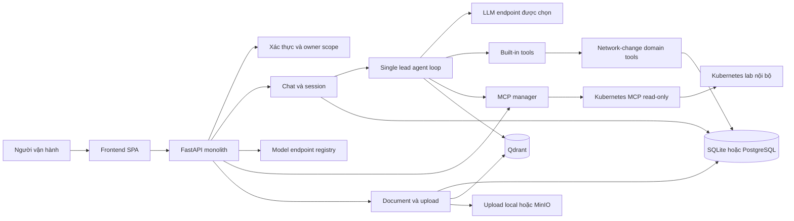

Các kết nối tới Kubernetes lab chỉ có quyền đọc tại baseline. Không có đường
thực thi nào từ `NetTools` có thể thay đổi cluster.

## 4. Kiến trúc thành phần

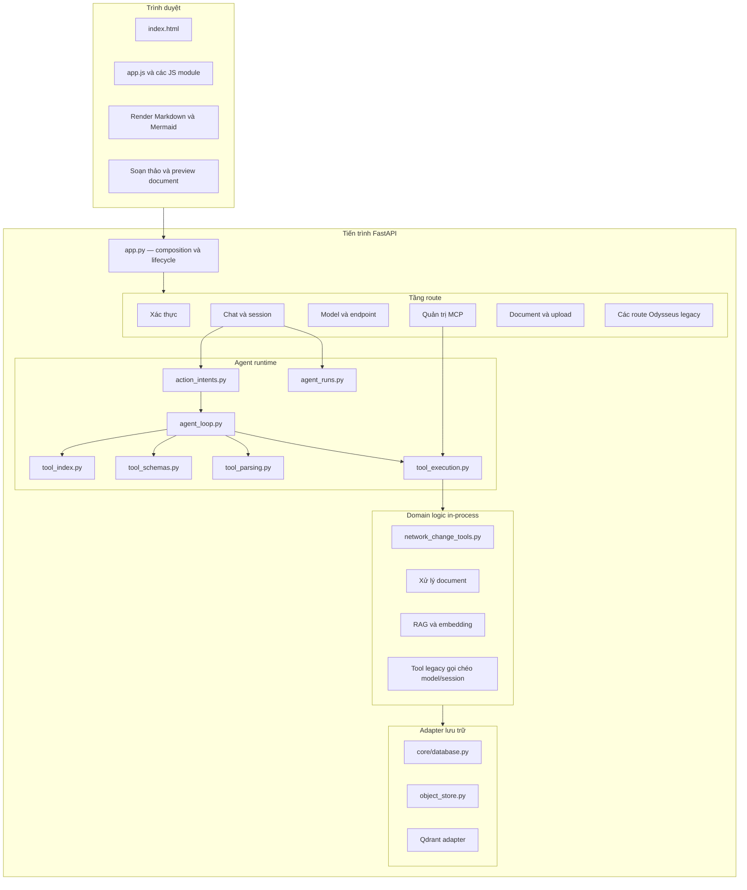

## 5. Ranh giới runtime và deployment

Lệnh:

```bash
python3 -m uvicorn app:app --host 0.0.0.0 --port 7000
```

chỉ khởi động tiến trình FastAPI bằng Python. Lệnh này không build Docker image
và không khởi động PostgreSQL hoặc Qdrant.

| Thành phần | Mặc định khi chạy Uvicorn trực tiếp | Cách triển khai tùy chọn |
|---|---|---|
| Dữ liệu quan hệ | `sqlite:///./data/app.db` | PostgreSQL có sẵn từ `DATABASE_URL` |
| Dữ liệu vector | Qdrant có sẵn từ `QDRANT_URL` | Không cần tạo Qdrant image mới |
| Nội dung document | SQL `documents` và `document_versions` | Mirror best-effort sang MinIO |
| Upload blob | `data/uploads/` | MinIO/S3 khi được bật |
| Agent-run replay | RAM của tiến trình | Không bền vững qua restart |
| User tool workspace | `data/userdata/<owner>/` | Có thể đồng bộ từ MinIO |

Source archive chủ đích không chứa runtime database, session, credential,
upload hoặc generated report.

## 6. Trình tự startup

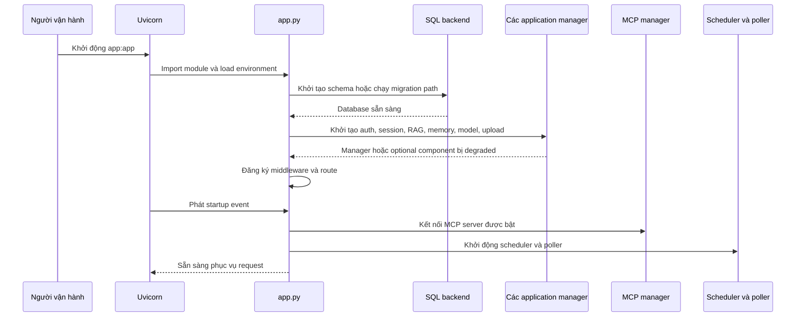

Optional service có thể degraded độc lập, nhưng lỗi database quan trọng hoặc
lỗi khởi tạo ứng dụng có thể làm readiness thất bại.

## 7. Trình tự lựa chọn model endpoint

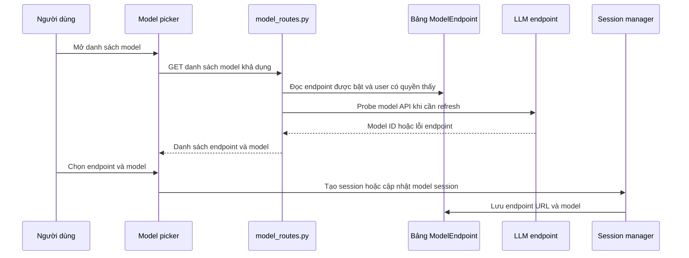

Model của session là lead model. Utility, teacher, task và fallback model chỉ
là các lời gọi hỗ trợ, không phải agent được deploy riêng.

## 8. Trình tự chat-only và agent mode

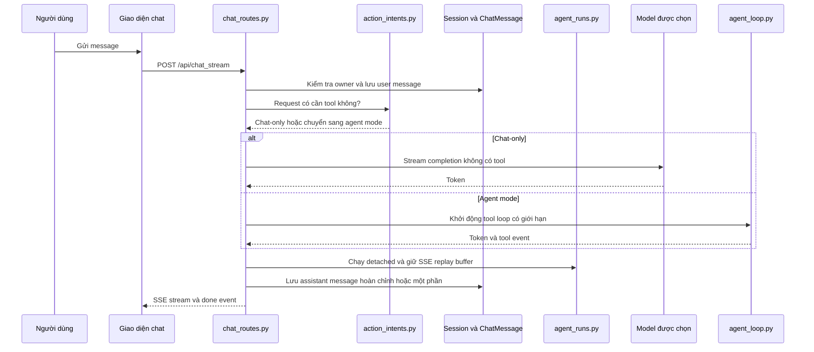

`agent_runs.py` giúp stream tiếp tục khi trình duyệt refresh hoặc mất kết nối,
nhưng replay buffer chỉ nằm trong RAM và bị loại sau khi run kết thúc.

## 9. Trình tự chọn và thực thi tool

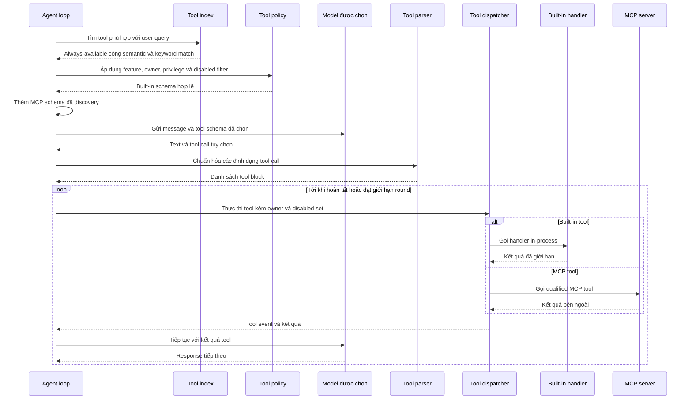

Giới hạn hiện tại: semantic relevance chủ yếu thu hẹp built-in tools. MCP
schema được discovery động và vẫn có thể làm context tăng đáng kể. Metadata
built-in tool còn bị khai báo lặp ở nhiều registry và frontend.

## 10. Lifecycle của MCP server

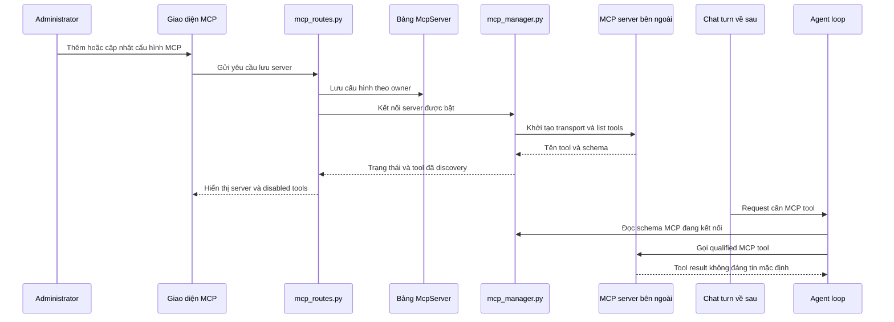

Frontend đã có quản trị MCP và disabled-tool theo server. Nó chưa có bộ chọn
`Disabled / Auto / Pinned` theo session cho toàn bộ built-in và MCP tool.

## 11. Trình tự tạo network-change proposal

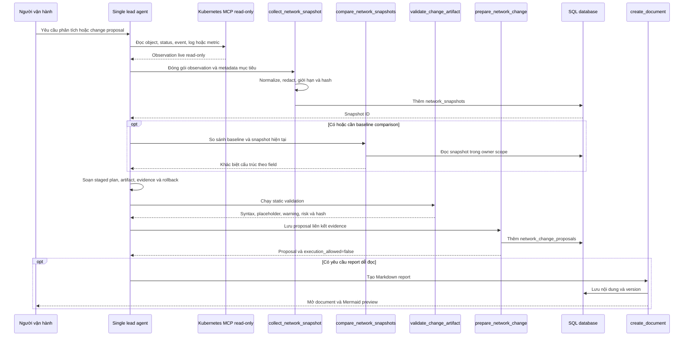

Agent phải gọi MCP trước. Network tool in-process không tự kết nối MCP và không
tự lấy cluster credential.

## 12. Static artifact validation hiện kiểm tra gì

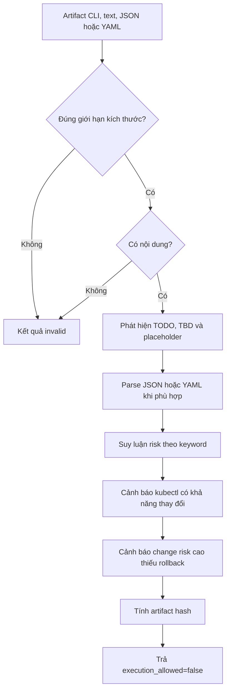

Với `format=cli`, validation hiện chủ yếu xử lý text. Nó chưa tạo AST cho
command, chưa resolve đầy đủ resource selector, chưa chạy server-side dry-run
và chưa chạy command trong môi trường rehearsal.

## 13. Ingest và truy xuất knowledge

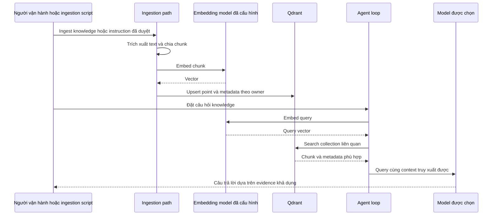

Qdrant lưu vector và payload metadata. Nó không phải nơi lưu chuẩn cho chat
message hoặc lịch sử version của document.

## 14. Sinh, lưu và export document

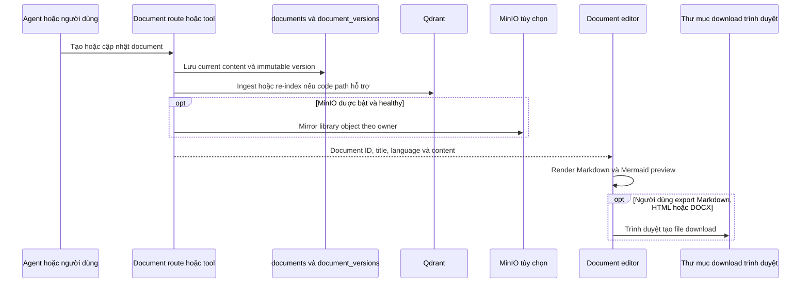

Tại baseline, Markdown do AI tạo có thể chỉ tồn tại dưới dạng bản ghi SQL cùng
MinIO object tùy chọn. Không đảm bảo có file `.md` dễ đọc trong
`data/userdata/<owner>/`.

## 15. Lưu session và lịch sử chat

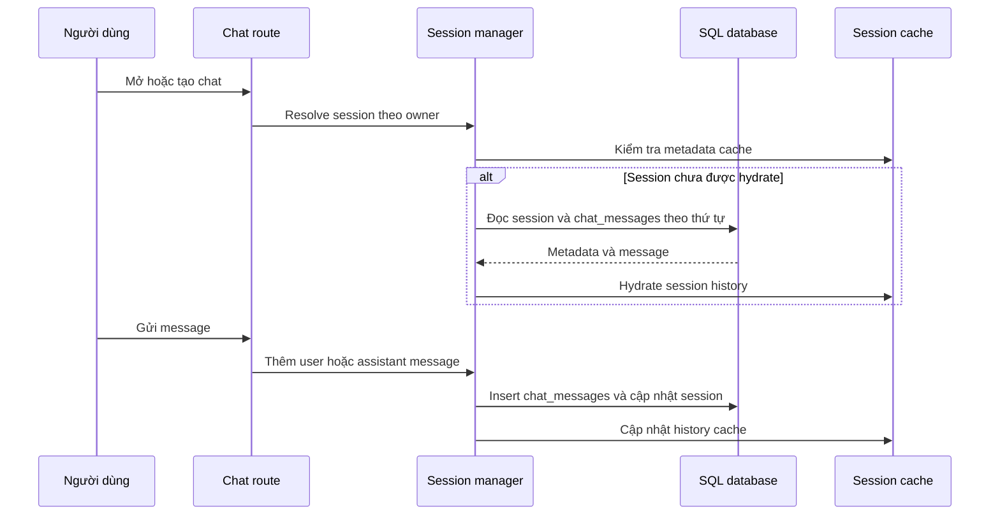

`data/sessions.json` chỉ còn là constant tương thích. Session manager lưu chat
history trong SQL. `data/userdata/<owner>/` là file workspace hoặc object-store
mirror, không phải chat database.

## 16. Các khả năng legacy gọi chéo model và session

| Chức năng | Hành vi hiện tại | Vấn đề cần xem xét |
|---|---|---|
| `chat_with_model` | Gọi hỗ trợ tới một model được chọn | Hữu ích như LLM-as-a-tool; nên giữ |
| `create_session` | Tạo chat khác với model được chọn và lưu DB | Không tạo service khác; có thể giữ cho explicit intent |
| `send_to_session` | Gọi model của session đích cùng history và lưu kết quả | Cần review owner-scope trước khi dùng rộng rãi |
| Generic `pipeline` | Gọi model tuần tự, output trước đi vào instruction sau | Không phải network-change stage runner và không có evidence/policy contract |
| Personal assistant/CrewMember | Persona, model, tools, session và scheduled check-in | Legacy abstraction, không thuộc kiến trúc single-lead đã chọn |

Sự tồn tại của các utility này không khiến chat thông thường trở thành hệ thống
multi-agent. Chúng chỉ tạo orchestration khi được gọi rõ ràng.

## 17. Các ranh giới security và isolation

### Owner scope

Session, document, model endpoint, cấu hình MCP, memory, snapshot và proposal
được thiết kế theo owner scope. Administrator là ngoại lệ có chủ đích ở một số
relational route.

### Giới hạn tool

Tool eligibility bị giới hạn bởi feature flag, privilege, global disabled
setting, request toggle và kiểm tra lúc thực thi. UI chưa có tri-state selector
theo session.

### Đường dẫn file

`read_file` và `write_file` resolve symlink, chặn các đường dẫn nhạy cảm và giới
hạn configured root. Cơ chế này không biến subprocess `bash` hoặc `python`
thành strong sandbox.

### HTML preview

HTML preview chạy trong browser iframe có sandbox attribute. Browser isolation
này không liên quan tới Kubernetes rehearsal.

### Kubernetes

Ranh giới an toàn hiện tại dựa trên việc không có implementation thực thi.
Domain tool không có đường thay đổi cluster và proposal luôn ghi execution
không được phép. Baseline chưa có Kubernetes sandbox.

## 18. Các nhóm chức năng hiện tại

### Network-change core hoặc hỗ trợ trực tiếp

- Authentication và owner context.
- Chat, session và history.
- Model/endpoint và embedding.
- Quản trị và gọi MCP.
- Knowledge/RAG và upload.
- Document, version, preview và export.
- Network snapshot, comparison, validation, proposal và history.
- Preferences, health/readiness, backup và cleanup cần thiết.

### Có thể hữu ích nhưng không bắt buộc

- Manual memory và skill/instruction đã duyệt.
- Scheduled task và webhook.
- External research/search.
- Preset.
- `chat_with_model` dưới dạng LLM tool.
- Tạo và quản lý session theo explicit user intent.

### Chức năng Odysseus tổng quát vẫn còn

- Email, calendar, contact, personal note và signature.
- Gallery và image editing.
- Text-to-speech và speech-to-text.
- Cookbook, hardware fitting và local model serving.
- Generic model comparison và deep research.
- Personal assistant/CrewMember.
- Generic shell, Python, internal API và cross-session utility.

Baseline chỉ ghi nhận sự tồn tại của chúng, không yêu cầu xóa tất cả. Refactor
nên ẩn hoặc disable theo profile trước, thu thập usage evidence và chỉ xóa code
sau khi kiểm tra dependency.

## 19. Những gì còn thiếu hoặc cần cập nhật

Đây là gap register trước refactor. Tiến độ phải được ghi trong báo cáo hậu
refactor mới; không ghi đè trạng thái trong baseline.

| Ưu tiên | Phần còn thiếu hoặc chưa nhất quán | Cập nhật/ quyết định cần có | Evidence nghiệm thu sau refactor |
|---|---|---|---|
| P0 | Chưa có unified tool registry | Một nguồn khai báo cho ID, schema, handler, category, risk, feature, intent tag và UI metadata | Tool mới xuất hiện đúng ở backend, similarity, dispatcher và UI mà không khai báo lặp |
| P0 | Chưa có `Disabled / Auto / Pinned` theo session | Thêm global hard ceiling và preference theo owner/session | Disabled không chạy; Auto được lọc; Pinned luôn hiện nhưng không vượt policy |
| P0 | MCP schema chưa dùng cùng relevance pipeline với built-in | Index mô tả MCP và áp dụng semantic/intent selection | Log cho thấy schema built-in/MCP được giới hạn theo request |
| P0 | Owner boundary của `send_to_session` cần review | Truyền caller owner và kiểm tra session đích | Cross-owner test bị chặn |
| P0 | CLI validation chỉ xử lý text | Thêm structured CLI/manifest parser và normalized change target | Test resolve operation, cluster, namespace, kind, name và selector |
| P0 | Chưa có affected-resource graph | Resolve workload, pod, service, endpoint, policy, volume và node qua MCP read-only | Proposal liệt kê resource bị ảnh hưởng kèm evidence |
| P0 | Chưa có Kubernetes rehearsal thật | Quyết định riêng về server dry-run và sandbox-only lab adapter | Báo cáo chứng minh allowlist, cleanup, before/after evidence và rollback result |
| P1 | Generated document chưa chắc có file local | Mirror sang `data/userdata/<owner>/generated/` sau DB commit | Current file và immutable version tồn tại, owner-confined và bền qua restart |
| P1 | Chat composer chưa recall kiểu terminal | Thêm Arrow Up/Down cho user message trong session hiện tại | Test previous/next, draft, session switch, multiline và autocomplete |
| P1 | Network profile chưa gate đồng nhất route/tool/UI/job | Tạo Network Change profile trước khi xóa code | Feature tắt biến mất khỏi UI/schema và không chạy backend |
| P1 | `ALWAYS_AVAILABLE` quá rộng | Giảm unconditional tools, chuyển tool rộng sang advanced/admin | Network prompt nhận schema set nhỏ nhưng đủ chức năng |
| P1 | Generic `pipeline` dễ nhầm với network plan | Đổi nhóm thành advanced multi-model chain và giải thích trên UI | Proposal flow không phụ thuộc generic pipeline |
| P1 | Feature flag không áp dụng đồng nhất | Một feature registry cho route, UI, tool, execution và startup | Tắt feature vô hiệu hóa mọi entry point |
| P1 | PUT/PATCH document có thể làm Qdrant cũ | Tập trung persistence và re-index policy | Nội dung sửa trên UI search được không cần backfill |
| P1 | `agent_runs.py` chỉ nằm trong RAM | Quyết định có cần restart durability không | Có quyết định rõ hoặc test persisted run qua restart |
| P1 | Tool audit chủ yếu trong RAM/log | Thêm audit bền vững theo owner nếu cần | Proposal đọc lại được tool call, outcome, retry và evidence sau restart |
| P2 | Tài liệu cũ còn mô tả Chroma/Odysseus rộng | Đánh dấu phần lịch sử và tạo post-refactor report | Index phân biệt baseline, tài liệu lịch sử và kiến trúc hiện hành |
| P2 | Thuật ngữ sandbox đang bị dùng rộng | Chỉ gọi Kubernetes sandbox khi có rehearsal thật | UI, prompt, README và report dùng thuật ngữ nhất quán |

### Ngoài phạm vi refactor hiện đang thảo luận

- Build PostgreSQL hoặc Qdrant Docker image mới.
- Thay đổi topology database hiện tại.
- Thực thi network change trên production.
- Automatic approval hoặc production rollback.
- ACE hoặc agent self-evolution.
- Tái lập planner, triage hoặc executor thành agent service riêng.

## 20. Yêu cầu đối chiếu sau refactor

Khi refactor hoàn thành, tạo file riêng:

```text
docs/ARCHITECTURE_POST_REFACTOR_<YYYY-MM-DD>.md
```

Báo cáo mới phải dùng các heading tương ứng và đối chiếu:

1. Ranh giới component và deployment.
2. Route đăng ký và UI module hiển thị.
3. Registry built-in/MCP tool.
4. Tool-selection policy và số schema trung bình.
5. Single-agent loop và supporting LLM call.
6. Lưu session/chat/document.
7. Local mirror generated file.
8. Ingest và truy xuất knowledge.
9. Network target parsing và impact graph.
10. Static validation, server dry-run và rehearsal.
11. Owner isolation và audit.
12. Test/evidence trên server nội bộ.

Sử dụng bảng đối chiếu:

| Hạng mục | Trước refactor | Sau refactor | Evidence |
|---|---|---|---|
| Tool registry | Khai báo ở nhiều nơi | Sẽ đo sau refactor | File link và test |
| Tool UI | Global disable và một số request toggle | Sẽ đo sau refactor | UI screenshot/test |
| MCP filtering | Dynamic schema được đưa vào khá rộng | Sẽ đo sau refactor | Selection log |
| Network validation | Static syntax/risk check | Sẽ đo sau refactor | Test và rehearsal record |
| Generated file | SQL cộng MinIO tùy chọn | Sẽ đo sau refactor | Filesystem và DB check |
| Route surface | Bộ feature Odysseus rộng | Sẽ đo sau refactor | Route inventory |

Baseline này phải được giữ cạnh báo cáo mới để người review xác minh thay đổi
mà không phụ thuộc vào trí nhớ hoặc tài liệu được sinh lại.
