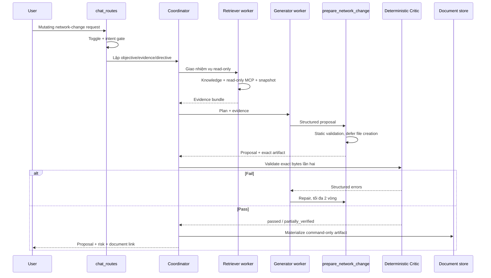

# Kiến trúc multi-agent Network Change — 2026-09-24

Tài liệu này mô tả **code đã triển khai**, không phải kiến trúc dự kiến.

## Phạm vi

Source vẫn là một FastAPI monolith và một image triển khai. Pipeline nhiều vai
trò chỉ được bật khi đồng thời thỏa mãn:

1. `network_change_multiagent=true` trong Settings.
2. UI đang ở Agent mode.
3. Intent chứa thao tác thay đổi network/Kubernetes hoặc yêu cầu sinh artifact
   CLI/manifest.

Q&A, truy vấn read-only, lấy trạng thái và tạo report vẫn chạy qua
`src/agent_loop.py` như trước.

## Luồng xử lý

## Các vai trò

### Coordinator

- Dùng endpoint prefix `coordinator` hoặc kế thừa model của chat.
- Chỉ phân rã yêu cầu thành objective, evidence cần lấy, target, directive và
  risk hint; không sinh CLI.
- Điều phối tuần tự và không có free-form A2A.

### Retriever

- Chạy trong child session tạm thời.
- Được phép dùng `search_knowledge`, `collect_network_snapshot`,
  `compare_network_snapshots` và MCP tool được nhận diện là read-only.
- Tên/description MCP có động từ mutate như apply/delete/patch/write/exec bị
  loại. Tool không nằm trong allowlist bị chặn bằng `disabled_tools` tại lúc
  thực thi.
- Không được tạo artifact hoặc document.

### Generator

- Chạy trong child session tạm thời.
- Chỉ được gọi `prepare_network_change`.
- `create_document`, edit/update document, shell, Python, file write, MCP và
  lateral dispatch đều bị chặn.
- Text tự do của worker không được forward ra UI.

### Critic

- Quyết định pass/block đến từ `do_validate_change_artifact`, chạy trực tiếp
  trong process trên đúng artifact bytes.
- Critic model (nếu cấu hình) chỉ tóm tắt risk/gap, không có quyền thay đổi
  verdict và không nhận nội dung command để tránh lặp CLI vào response.

## Enforcement

1. **Execution allowlist:** Generator chỉ còn `prepare_network_change`; block
   vẫn có hiệu lực dù tool bị `ALWAYS_AVAILABLE` đưa lại vào schema.
2. **Deferred materialization:** `ContextVar` trong
   `src/network_change_tools.py` ngăn tạo file khi Generator đang draft.
3. **Deterministic validation:** `prepare_network_change` validate lần một;
   Critic validate exact bytes lần hai.
4. **No failed artifact:** nếu fail, CLI bytes không xuất hiện trong chat/file
   và bị bỏ khỏi invalid audit record, chỉ giữ format/hash/error metadata.
5. **Human review only:** mọi kết quả giữ `execution_allowed=false`; source
   không có production executor hoặc approval engine.

## Model endpoint

Các setting sau có thể để trống để kế thừa model chat:

- `coordinator_endpoint_id`, `coordinator_model`
- `retriever_endpoint_id`, `retriever_model`
- `generator_endpoint_id`, `generator_model`
- `critic_endpoint_id`, `critic_model`

Resolver vẫn là `src/endpoint_resolver.py`; không có ModelRouter riêng và không
bắt buộc chạy bốn vLLM server. Nên chọn Critic khác Generator khi hạ tầng cho
phép, nhưng deterministic validator mới là security boundary.

## File chính

| Chức năng | File |
|---|---|
| Intent gate và role orchestration | `src/multiagent.py` |
| General agent loop | `src/agent_loop.py` |
| Route chọn pipeline | `routes/chat_routes.py` |
| Validator/proposal/materialization | `src/network_change_tools.py` |
| Settings backend | `src/settings.py` |
| Settings UI | `static/index.html`, `static/js/settings.js` |
| Regression tests | `tests/test_multiagent.py`, `tests/test_network_change_tools.py` |

## Giới hạn còn lại

- Không có digital twin hoặc vendor emulator; `partially_verified` không đồng
  nghĩa đã chạy thử trên production.
- Nhận diện MCP read-only dựa trên name/description và vẫn cần MCP server/RBAC
  read-only làm trust boundary thực tế.
- Worker sessions, MCP connections và agent-run replay vẫn process-local; giữ
  một replica.
- Pipeline chưa thực thi, approve, rollback hoặc sửa live system.
- Cần smoke test lại trên server với endpoint GLM và MCP tool schemas thực tế.

