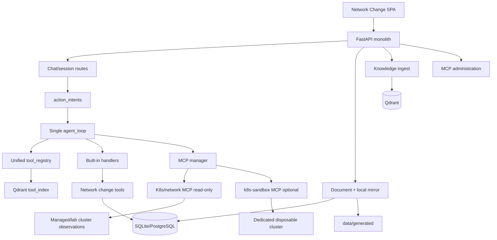
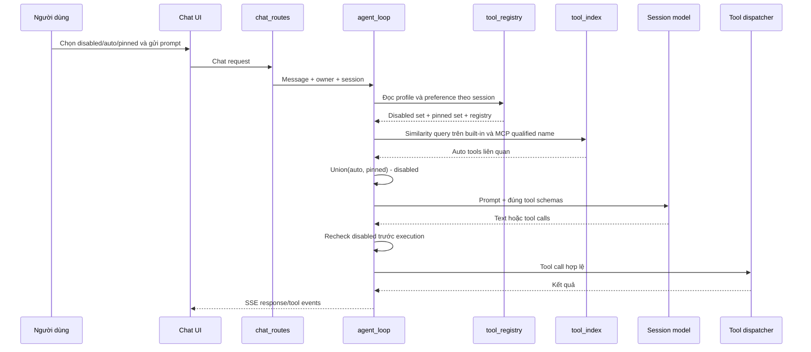
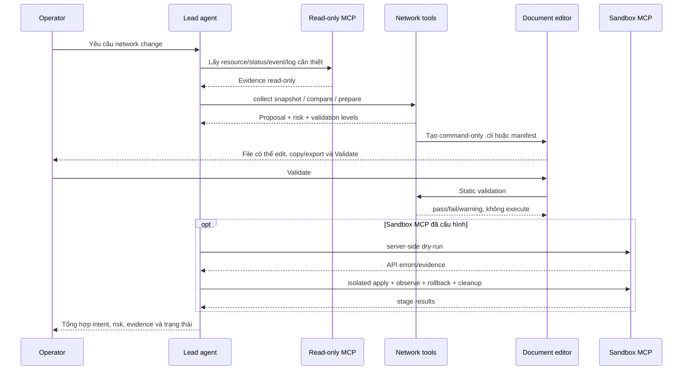

# Kiến trúc nc_v7 monolith — sau refactor Network Change

> **Ngày cập nhật:** 2026-09-14  
> **Mốc đối chiếu:** `ARCHITECTURE_BASELINE_2026-09-14_VI.md`  
> **Profile mặc định:** `APP_PROFILE=network_change`

## 1. Kết quả refactor

Ứng dụng vẫn là một FastAPI monolith và một lead agent loop. Refactor không tạo
planner/triage/executor agent service mới, không thay đổi cách chọn model của
session, và không tạo PostgreSQL/Qdrant container khi chạy Uvicorn.

Những thay đổi đã triển khai:

- Profile Network Change allow-list route/tool tại composition boundary.
- Prompt recall bằng Arrow Up/Down, theo session và có giữ draft hiện tại.
- Một registry chung cho built-in và MCP tool với ID canonical.
- Ba mode theo session: `disabled`, `auto`, `pinned`.
- Similarity filtering áp dụng cho tên MCP qualified, không còn gửi toàn bộ MCP
  schema khi chỉ một số tool liên quan.
- Knowledge/instruction có thể ingest bằng CLI hoặc Settings > Knowledge Base.
- Document của session được mirror ra `data/generated/` ngoài bản SQL/MinIO.
- Artifact `network-cli` và `kubernetes` có editor; nút **Validate** không gọi
  host shell.
- Validator trả các mức kiểm chứng, thay vì một boolean gây hiểu nhầm.
- MCP Kubernetes sandbox là process riêng, chỉ dùng kubeconfig lab riêng.

Quyết định với ba tool orchestration cũ:

- `create_session` được giữ: lead agent có thể tạo một session/chat mới khi
  nhiệm vụ thực sự cần một workspace tách biệt.
- `send_to_session` bị chặn trong profile mặc định vì nó điều phối một agent
  loop ở session khác, không cần cho Q&A, report hay document của lead hiện tại.
- Generic `pipeline` bị chặn vì nó chạy nhiều prompt/model theo stage và tạo
  một lớp orchestration thứ hai. Network-change proposal vẫn có staged plan,
  nhưng chính một lead agent loop thực hiện các stage bằng tool calls.
- Teacher escalation và việc tự ghi skill từ kết quả teacher cũng không chạy
  trong profile này; skill/instruction do người dùng quản lý vẫn được giữ.

Hai tool bị chặn không bị xóa vật lý; `APP_PROFILE=legacy` là đường rollback nếu
server soak-test cho thấy một workflow cũ thực sự phụ thuộc vào chúng.

## 2. Kiến trúc thành phần sau refactor

## 3. Trình tự chat và chọn tool

## 4. Trình tự network change và validation

## 5. Ý nghĩa các mức validation

| Mức | Nguồn kiểm chứng | Có thể báo gì |
|---|---|---|
| `static` | Parser/linter trong monolith | Cú pháp, placeholder, lệnh nguy hiểm |
| `instruction_grounding` | Knowledge/instructions đã retrieve | Lệnh có căn cứ tài liệu hay chưa |
| `live_preconditions` | Snapshot MCP read-only mới | Target và precondition hiện tại |
| `api_dry_run` | Sandbox API server | Kubernetes schema/admission |
| `sandbox_apply` | Namespace disposable | Resource có tạo được trong lab |
| `runtime_probes` | Quan sát workload sandbox | Readiness/resource observation |
| `rollback_test` | Apply rollback trong sandbox | Rollback có thực hiện được |
| `vendor_runtime` | Emulator/test node vendor | Chỉ pass khi có môi trường thật |

Không có sandbox/evidence đầy đủ thì status là `partially_verified`; model không
được tự nâng thành `passed`.

## 6. Lưu trữ sau refactor

| Dữ liệu | Nơi lưu |
|---|---|
| Session/chat/document/version/proposal/snapshot | SQLite hoặc PostgreSQL |
| Knowledge và tool embeddings | Qdrant |
| Document object | MinIO nếu bật |
| Bản file đọc trực tiếp | `data/generated/<owner>/<session>/` |
| Tool preference | `data/tool_preferences.json`, theo owner/session |
| Knowledge thêm từ UI | `knowledge_base/user/<owner>/<role>/` + Qdrant |

Uvicorn không tạo Docker image cho bất kỳ database nào.

## 7. Đối chiếu với baseline

| Baseline | Sau refactor |
|---|---|
| MCP similarity chỉ thực tế lọc built-in | Lọc cả built-in và MCP qualified schema |
| Toggle built-in/MCP rời rạc | Registry chung + tri-state theo session |
| Không có prompt recall | Arrow Up/Down theo lịch sử user prompt |
| Document chủ yếu SQL/MinIO | Thêm local mirror trong `data/generated` |
| Knowledge ingest chỉ CLI/generic upload | CLI + UI có role knowledge/instructions |
| Validator static boolean | Validation levels + `partially_verified` |
| Run Bash có thể gọi host shell | Network CLI không có Run; chỉ Validate |
| Không có sandbox | Có adapter MCP riêng, opt-in, lab-only |
| Route Odysseus đăng ký rộng | Profile Network Change không đăng ký route legacy |

## 8. Những phần còn thiếu/cần update

1. Chưa có vendor EMS/MME emulator; vendor CLI chưa thể runtime-pass.
2. Sandbox chưa mô phỏng đầy đủ CNI, traffic thật, node failure, storage hoặc
   controller đặc thù của production.
3. Chưa có UI timeline riêng cho snapshot/proposal/sandbox run; hiện kết quả đi
   qua response/tool event và document panel.
4. Chưa có automatic repair policy riêng cho từng stage; bounded agent loop có
   thể sửa theo lỗi tool nhưng model không được tự chứng nhận kết quả.
5. Tool preference hiện là JSON owner-scoped, chưa migrate sang PostgreSQL.
6. Các module legacy còn nằm trong source để rollback nhưng không được register
   ở profile mặc định; có thể xóa vật lý ở đợt sau khi server soak-test ổn định.
7. Agent-run replay vẫn ở RAM, chưa bền qua restart và chưa phù hợp multi-replica.
8. Cần test tích hợp trên sandbox cluster nội bộ với RBAC tối thiểu trước khi bật
   `K8S_SANDBOX_ENABLE_APPLY=true`.
9. Sandbox result đã bị buộc với SHA-256 của artifact và phải có stage
   `api_dry_run`, nhưng chưa có chữ ký/attestation độc lập; về dài hạn nên lưu
   execution record phía server thay vì để model chuyển tiếp JSON tool result.
